# # 요구사항 분석 및 설계 작성

>  [!NOTE]
>**프로젝트 전체 자료 모음 (단계별 AI 사용내역) : https://noctis-03.github.io/FinalJavaProject/**  
> 


##  0. 목차

- [기능적 요구사항](#1-기능적-요구사항)
    - 요구사항 개요
    - 기능의 구조 파악
    - 기능 상세
- [비기능적 요구사항](#2-비기능적-요구사항)
- [시스템 설계](#3-시스템-설계)
    - 프로젝트 구조
    - 데이터베이스 스키마  


## 1. 기능적 요구사항  

### 1.1 요구사항 개요

| ID | 요구사항명 | 개요 | 우선순위 |
|------|------------|------|:--------:|
| FR-01 | 블록 기반 캘린더 페이지 | 블록 단위로 일정을 생성, 배치, 이동할 수 있는 기능 및 기본적인 캘린더 시스템 전용 페이지 | 상 |
| FR-02 | 미리블록 템플릿 | 자주 사용하는 일정을 재사용 가능한 블록 템플릿으로 저장·배치 | 상 |
| FR-03 | 과목 페이지 | 과목별로 과제, 자료를 구조화하여 관리하는 전용 페이지 | 상 |
| FR-04 | 과제 블록 | 과제 생성 시 마감일 캘린더 자동 연동 및 작업 일정 배치 | 상 |
| FR-05 | 파일 블록 | 강의 자료, 제출 파일을 블록 단위로 정리·관리 | 상 |
| FR-06 | 텍스트 블록 | 텍스트를 입력 가능한 블록 | 중 |
| FR-07 | 링크 블록 | 입력한 인터넷 주소로 이동 | 중 |
| FR-08 | 무한 캔버스 보드 | 파일블록을 보드 위에 자유 배치하여 멀티태스킹 | 중 |
| FR-09 | 시간표 입력 | 학기별 수강 과목과 시간을 입력·관리 | 중 |
| FR-10 | 과제 입력 | 캘린더 페이지의 과제 블록의 연동 | 중 |
| FR-11 | 드래그 앤 드롭 조작 | 블록의 생성, 이동, 삭제를 드래그 앤 드롭으로 수행 | 중 |
| FR-12 | 자동화 시스템 | 자동화 블록을 통한 실행 | 중 |
| FR-13 | 자동화 블록 | 자동화 시스템에서 사용할 프롬프트형 블록 | 중 |
| FR-14 | 날씨 | 내일 날씨를 간단히 표시 | 하 |
| FR-15 | 대학 정보 블록 | 장학금, 캠프, 프로그램, 공지사항 등 대학 관련 정보 표시 | 하 |
| FR-16 | 필기 | 무한 캔버스 보드나 파일에서의 간단한 필기 | 하 |  

---

### 1.2 기능의 구조 파악  

- 캘린더 페이지
  - 미리 블록 (템플릿)
  - 과제 블록
  - 자동화 시스템 (캘린더형)
  - 자동화 블록 (캘린더형)
  - 날씨

- 과목 페이지
  - 파일 블록
  - 텍스트 블록
  - 링크 블록
  - 무한 캔버스 보드
  - 시간표 입력
  - 과제 입력
  - 드래그 앤 드롭 조작
  - 대학 정보 블록
  - 필기  
  - 자동화 시스템 (캔버스형)
  - 자동화 블록 (캔버스형)
  - 날씨
---

### 1.3 요구사항 상세   

<details>
<summary>FR-01 | 블록 기반 캘린더 페이지</summary>

>**개요:**  
> 사용자는 블록 단위로 일정을 생성하고, 캘린더 위에서 드래그 앤 드롭으로 자유롭게 배치·이동할 수 있다.

>**상세 내용:**  
>- 캘린더는 주간 뷰와 월간 뷰를 제공한다.
>- 사용자는 캘린더의 특정 시간대를 클릭하거나 드래그하여 새로운 '일정 블록'을 생성할 수 있다.
>- 생성된 블록에는 일정명, 시작/종료 시간, 색상을 설정할 수 있다.
>- 블록을 드래그하여 다른 날짜/시간대로 이동할 수 있다.
>- 블록의 상하 경계를 드래그하여 시간 범위를 조절할 수 있다.
>- 동일 시간대에 블록이 겹칠 경우 시각적으로 충돌을 표시한다.

>**예외 처리:**  
>- 블록을 캘린더 영역 밖으로 드래그할 경우 원래 위치로 복귀한다.
>- 시작 시간이 종료 시간보다 늦을 경우 경고 메시지를 표시한다.

>**입력:**  
>일정명, 시작/종료 시간, 색상, 메모(선택)

>**출력:**  
>캘린더 상의 시각적 블록 배치

</details>

<details>
<summary>FR-02 | 미리블록 템플릿 기능</summary>

>**개요:**   
>사용자는 반복적으로 사용하는 일정을 '미리블록'으로 저장해두고, 필요할 때 캘린더 위에 드래그 앤 드롭으로 빠르게 배치할 수 있다.

>**상세 내용:**  
>- 미리블록 생성 시 블록 이름, 기본 소요 시간, 색상, 카테고리(학업/운동/아르바이트 등)를 설정한다.
>- 생성된 미리블록은 캘린더 좌측 또는 별도 패널에 목록으로 표시된다.
>- 미리블록을 캘린더 위 원하는 시간대로 드래그하면 해당 위치에 일정 블록이 생성된다.
>- 하나의 미리블록은 여러 번 재사용할 수 있다 (인스턴스 방식).
>- 미리블록 템플릿을 수정하면, 이미 배치된 인스턴스에는 영향을 주지 않는다.
>- 미리블록 삭제 시 확인 다이얼로그를 표시한다.

>**예외 처리:**  
>- 동일 이름의 미리블록 생성 시 "이미 존재하는 이름입니다" 안내 표시
>- 미리블록 목록이 비어있을 경우 생성 유도 안내 메시지 표시

>**입력:**  
>블록 이름, 소요 시간, 색상, 카테고리

>**출력:**  
>미리블록 패널에 템플릿 등록, 캘린더에 인스턴스 배치

</details>

<details>
<summary>FR-03 | 과목 페이지</summary>

>**개요:**  
> 사용자는 수강 중인 각 과목에 대해 전용 페이지를 생성하여, 과제·강의 자료·메모 등을 구조화하여 관리할 수 있다.

>**상세 내용:**
>- 과목 페이지의 '시간표 입력' 기능에 입력된 과목이 자동으로 과목 페이지 목록에 추가된다.
>- 과목 페이지 내에서 과목별 메뉴가 화면 좌측에 '과목 목록'으로 존재하며 각 과목을 눌러 과목별 강의자료와 과제 자료 등을 업로드하여 '파일 블록' 형식으로 저장한다.
>- 사용자는 과목 페이지 내 블록들을 원하는 기준(주차별, 유형별 등)으로 구분하여 배치할 수 있는 필터 또는 정렬 기능이 존재하며 현재 정렬 상태를 저장할 수 있다.
>- 과목별 색상 지정이 가능하며, 캘린더의 해당 과목 블록에도 동일 색상이 적용된다.

>**예외 처리:**
>- 과목 삭제 시 관련 과제블록·파일블록 처리 여부를 확인하는 다이얼로그 표시
>- 과목명 미입력 시 저장 불가

>**입력:**  
>과목명, 교수명, 강의실, 색상

>**출력:**  
>과목 전용 페이지 생성 및 블록 관리 인터페이스

</details>

<details>
<summary>FR-04 | 과제블록</summary>

>**개요:**  
> 사용자는 과목 페이지 내의 '과제 입력' 기능을 통해 '과제 블록'을 생성한다. 과제 정보 등록과 동시에 캘린더에 마감일을 자동 연동하여 표시하고, 실제 과제를 수행할 작업 일정을 '과제 블록'으로 배치할 수 있다.

>**상세 내용:**
>- 과제블록 생성 시 과제명, 제출 마감일시, 과제 설명(선택), 첨부파일(선택)을 입력한다.
>- 마감일 입력 시 캘린더의 해당 날짜에 "마감" 표시가 자동 생성된다.
>- 과제블록을 캘린더의 특정 날짜/시간대에 드래그하여 "작업 예정일"로 배치할 수 있다.
>- 과제 상태를 관리할 수 있다 (미시작 / 진행중 / 완료).
>- 마감일이 임박한 과제(예: 3일 이내)는 시각적으로 강조 표시된다.
>- 과제블록의 마감일 수정 시 캘린더의 마감 표시도 자동 업데이트된다.
>- 상태가 '완료'로 변경되면 블록에 완료 표시(체크 또는 취소선)가 적용된다.
>- 마감일 3일 이내인 과제는 블록 테두리 강조 또는 경고 아이콘으로 시각적 알림을 제공한다.
>- 과제블록 삭제 시 캘린더의 마감 표시 및 작업 예정일 블록도 함께 삭제 여부를 확인한다.

>**예외 처리:**  
>- 마감일이 현재 날짜보다 과거인 경우 경고 표시 (단, 생성은 허용)
>- 과제명 미입력 시 저장 불가

>**입력:**  
>과제명, 마감일시, 설명, 첨부파일

>**출력:**  
>캘린더에 과제블록 표시, 캘린더에 마감일·작업일 연동

</details>


<details>
<summary>FR-05 | 파일블록</summary>

>**개요:**   
> 사용자는 과목 페이지 내에서 파일블록을 생성하여 강의 자료, 과제 제출물 등을 체계적으로 정리할 수 있다.

>**상세 내용:**  
>- 파일블록 생성 시 로컬 파일을 선택하여 등록한다.
>- 파일블록에는 파일명, 등록일, 파일 유형 아이콘, 메모(선택)가 표시된다.
>- 파일블록을 더블클릭하면 시스템 기본 프로그램으로 파일이 열린다.
>- 파일블록을 무한 캔버스 보드로 드래그하여 멀티태스킹 환경에서 활용할 수 있다.
>- 이때 파일은 프로그램 안에서 열린다.
>- 지원 파일 형식: PDF, HWP, DOCX, PPTX, PNG, JPG, TXT 등
>- 파일블록에 태그(예: "1주차", "중간고사 범위")를 부여하여 필터링할 수 있다.

>**예외 처리:**
>- 지원하지 않는 파일 형식 등록 시도 시 안내 메시지 표시
>- 파일 경로가 유효하지 않을 경우(삭제/이동됨) 경고 표시

>**입력:**  
>파일 선택, 태그(선택), 메모(선택)

>**출력:**  
>과목 페이지 내 파일블록 표시, 파일 열기 기능

</details>

<details>
<summary>FR-06 | 텍스트 블록</summary>

>**개요:**  
>사용자는 무한 캔버스 보드 위에 텍스트 블록을 생성하여 메모, 포스트잇 형태의 자유로운 텍스트 기록을 남길 수 있다.

>**상세 내용:**  
>- 무한 캔버스 보드에서 우클릭 메뉴 또는 도구 패널을 통해 텍스트 블록을 생성할 수 있다.
>- 텍스트 블록은 포스트잇 형태의 시각적 디자인을 가지며, 배경 색상을 선택할 수 있다 (예: 노랑, 분홍, 연두, 하늘 등).
>- 텍스트 블록을 클릭하면 편집 모드로 전환되어 텍스트를 입력·수정할 수 있다.
>- 텍스트 블록은 보드 위에서 자유롭게 드래그하여 위치를 이동할 수 있다.
>- 텍스트 블록의 크기를 드래그로 조절할 수 있으며, 내용이 영역을 초과할 경우 스크롤이 생성된다.
>- 텍스트 블록에 제목(선택)과 본문을 구분하여 작성할 수 있다.
>- 텍스트 블록 삭제 시 확인 다이얼로그를 표시한다.

>**예외 처리:**  
>- 본문이 비어 있는 상태로 블록 외부를 클릭할 경우, 빈 텍스트 블록 유지 여부를 확인하거나 자동 삭제한다.
>- 텍스트 입력 중 프로그램이 비정상 종료될 경우, 자동 저장된 마지막 상태로 복원한다.
>- 보드 영역 밖으로 드래그 시 블록이 원래 위치로 복귀한다.

>**입력:**  
>텍스트 내용, 배경 색상 선택, 위치 및 크기 조절

>**출력:**  
>무한 캔버스 보드 위에 포스트잇 형태의 텍스트 블록 표시

</details>

<details>
<summary>FR-07 | 링크 블록</summary>

>**개요:**   
> 사용자는 무한 캔버스 보드 또는 과목 페이지에서 링크 블록을 생성하여 외부 URL(참고 사이트, 강의 영상, 자료 링크 등)을 저장하고 빠르게 접근할 수 있다.

>**상세 내용:**  
>- 링크 블록 생성 시 URL을 입력하면 자동으로 해당 링크의 제목(페이지 타이틀)을 가져와 표시한다.
>- 사용자가 링크 블록의 표시 이름을 직접 수정할 수 있다 (예: "3주차 참고 영상").
>- 링크 블록을 클릭(또는 더블클릭)하면 시스템 기본 브라우저에서 해당 URL이 열린다.
>- 링크 블록은 무한 캔버스 보드 위에 자유롭게 배치하거나, 과목 페이지 내에 정리할 수 있다.
>- 링크 블록에 태그(예: "중간고사 범위", "과제 참고")를 부여하여 분류할 수 있다.
>- 링크 블록은 파비콘 또는 링크 유형 아이콘(영상, 문서, 웹페이지 등)을 시각적으로 표시한다.
>- 링크 블록에 간단한 메모를 추가할 수 있다 (예: "2장 부분만 참고").

>**예외 처리:**  
>- URL 형식이 유효하지 않을 경우 (http/https 미포함 등) "유효하지 않은 URL입니다" 안내 표시
>- 페이지 타이틀 자동 가져오기 실패 시 (네트워크 미연결 등) URL 자체를 표시 이름으로 사용
>- 링크 클릭 시 브라우저를 열 수 없는 환경일 경우 URL을 클립보드에 복사하고 안내 메시지 표시

>**입력:**  
>URL, 표시 이름(선택), 태그(선택), 메모(선택)

>**출력:**  
>링크 아이콘과 제목이 표시된 블록, 클릭 시 외부 브라우저 연결

</details>

<details>
<summary>FR-08 | 무한 캔버스 보드</summary>

>**개요:**  
>사용자는 보드 위에 파일블록을 자유롭게 배치하고 동시에 여러 자료를 참조하며 멀티태스킹할 수 있다.

>**상세 내용:**  
>- 보드는 상하좌우 무한 스크롤이 가능한 캔버스 형태이다.
>- 과목 페이지의 여러 블록들을 보드로 드래그하여 배치할 수 있다.
>- 캔버스는 격자 무늬를 가지고 있다.
>- 보드 위의 블록은 자유 위치에 배치되지만 정렬을 위해 격자 무늬 위에 스냅된다.
>- 보드 위에서 블록은 크기 조절이 가능하다.
>- 보드 위에서 블록을 더블클릭하면 해당 파일이 열린다.
>- 보드의 줌 인/아웃 기능을 제공한다.
>- 보드 상태(배치 위치, 크기)는 자동 저장된다.

>**예외 처리:**  
>- 보드에 배치된 파일의 원본이 삭제된 경우 "파일을 찾을 수 없음" 표시

>**입력:**  
>파일블록 드래그, 위치/크기 조절

>**출력:**  
>캔버스 위 배치된 블록 뷰

</details>

<details>
<summary>FR-09 | 시간표 입력</summary>

>**개요:**  
> 사용자는 학기별 수강 과목과 요일·시간을 입력하여 주간 시간표를 구성할 수 있다.

>**상세 내용:**  
>- 학기(예: 2026-1학기)를 생성하고 해당 학기의 시간표를 관리한다.
>- 과목 추가 시 과목명, 요일, 시작/종료 시간, 강의실, 교수명을 입력한다.
>- 입력된 시간표는 주간 시간표 그리드 형태로 시각화된다.
>- 시간표에 등록된 과목은 캘린더에 매주 반복 블록으로 자동 표시된다.
>- 시간표에 등록된 과목은 자동으로 과목 페이지가 생성된다.
>- 동일 시간대에 과목이 겹칠 경우 충돌 경고를 표시한다.

>**예외 처리:**  
>- 필수 항목(과목명, 요일, 시간) 미입력 시 저장 불가
>- 시간 범위가 유효하지 않을 경우 (시작 > 종료) 오류 안내

>**입력:**  
>학기명, 과목명, 요일, 시간, 강의실, 교수명

>**출력:**  
>주간 시간표 뷰, 캘린더 반복 블록, 과목 페이지 자동 생성

</details>

<details>
<summary>FR-10 | 과제 입력</summary>

>**개요:**  
>사용자는 과목 페이지 내에서 과제 정보를 입력하여 과제블록을 생성하고, 마감일을 캘린더에 자동 연동하며, 작업 일정을 계획할 수 있다.

>**상세 내용:**  
>- 과목 페이지에서 '과제 추가' 버튼 또는 메뉴를 통해 과제 입력 폼을 열 수 있다.
>- 과제 입력 시 필수 항목은 과제명과 제출 마감일시이다.
>- 선택 항목으로 과제 설명, 배점/비중, 제출 방식(온라인/오프라인), 첨부파일을 입력할 수 있다.
>- 마감일시를 입력하면 캘린더의 해당 날짜에 마감 표시 블록이 자동 생성된다.
>- 과제 상태를 선택할 수 있다 (미시작 / 진행중 / 완료).

>**예외 처리:**  
>- 과제명이 비어 있을 경우 저장 불가, "과제명을 입력해주세요" 안내 표시
>- 마감일이 미입력일 경우 저장 불가, "마감일을 설정해주세요" 안내 표시
>- 마감일이 현재 날짜보다 과거인 경우 "마감일이 이미 지났습니다" 경고 표시 (단, 생성은 허용)
>- 동일 과목 내 동일 이름의 과제 생성 시도 시 "같은 이름의 과제가 이미 존재합니다" 안내 표시

>**입력:**  
>과제명, 마감일시, 과제 설명(선택), 배점/비중(선택), 제출 방식(선택), 첨부파일(선택)

>**출력:**  
>캘린더에 마감일 블록 자동 연동

</details>

<details>
<summary>FR-11 | 드래그 앤 드롭 조작</summary>

>**개요:**  
>프로그램 전반에서 블록의 생성·이동·재배치를 드래그 앤 드롭 방식으로 직관적으로 수행할 수 있다.

>**상세 내용:**  
>- 캘린더 내 블록 이동: 블록을 잡아 다른 시간/날짜로 드래그하여 이동
>- 미리블록 → 캘린더: 미리블록 패널에서 캘린더로 드래그하여 인스턴스 생성
>- 과제블록 → 캘린더: 과제블록을 캘린더로 드래그하여 작업 예정일 배치
>- 파일블록 → 보드: 파일블록을 무한 캔버스 보드로 드래그하여 배치
>- 드래그 중 블록은 반투명 상태로 표시되며, 배치 가능 영역이 하이라이트된다.

>**예외 처리:**  
>- 유효하지 않은 영역에 드롭 시 원래 위치로 복귀

>**입력:**  
>마우스 드래그 이벤트

>**출력:**  
>블록의 위치 변경 및 시각적 피드백

</details>

<details>
<summary>FR-12 | 자동화 시스템</summary>

>**개요:**  
>사용자는 자동화 블록을 생성하여 특정 조건(트리거)이 충족되면 지정된 동작(액션)이 자동으로 실행되도록 설정할 수 있다. 갤럭시의 루틴, 아이폰의 단축어와 유사한 "조건 → 실행" 구조이다.

>**상세 내용:**  
>- '자동화 블록'은 트리거(조건)와 액션(실행)의 조합으로 구성된다.
>- 트리거와 액션을 블록 형태로 조립하여 자동화 루틴을 만들 수 있다.
>- '캘린더 페이지'와 '과목 페이지'에서의 자동화는 서로 구분 되어 있다.
>- '캘린더 페이지'는 자동화 생성 화면이 '무한 캔버스' 형식과 동일한 형식으로 따로 구성되어 있으며 과목페이지는 무한 캔버스안에서 동작한다.

>- '캘린더 페이지'의 자동화는 예를 들면 '일정 등록 블록', '다음 주 블록'과 '요일 블록', '미리 블록', '실행 버튼'이 있다.
>- '다음 주 블록'은 프로그램이 현재 날짜를 확인하여 다음 주를 확인한다. 요일 블록은 월, 화, 수 와 같이 다중 선택이 가능한 블록이다. 이를 '일정 등록 블록'의 칸에 드래그 엔 드롭하여 넣는다.
>- '일정 등록 블록'이 "( 1 )의 ( 2 ) 요일에 ( 3 )일정을 추가한다." 라는 문구가 있으면 1에는 '다음 주 블록' 2에는 '요일 블록' 3에는 '미리 블록'을 넣어 실행 버튼을 연결시켜 버튼을 누르면 작동한다.

>- '과목 페이지'에서는 자동화 시스템을 무한 캔버스안에서 바로 사용하는 방식이며 '링크블록' 과 '파일블록'을 연결시켜 실행버튼을 누르면 한번에 실행되는 것이 있다.

>**입력:**  
>트리거 조건 선택/설정, 액션 유형 선택/설정, 자동화 이름(선택)

>**출력:**  
>조건 충족 시 설정된 액션 자동 실행, 실행 이력 로그 기록, 자동화 관리 패널에 목록 표시

</details>

<details>
<summary>FR-13 | 자동화 블록</summary>

>**개요:**  
> 자동화 시스템에서 사용할 프롬프트형 블록

>**상세 내용:**  
> '일정 등록 블록', '요일 블록'등이 자동화 블록의 요소이다.

</details>

<details>
<summary>FR-14 | 날씨</summary>

>**개요:**   
> 날씨를 표시한다.

>**상세 내용:**   
> '캘린더 페이지'의 우측 상단에 작게 내일을 날씨를 표시한다. 추후 업데이트를 하여 일단 보류한다.

</details>

<details>
<summary>FR-15 | 대학 정보 블록</summary>

>**개요:**   
> 대학 관련 정보 표시

>**상세 내용:**  
>  장학금, 캠프, 프로그램, 공지사항 등 대학 관련 정보 표시. 추후 업데이트하여 일단 보류

</details>

<details>
<summary>FR-16 | 필기 기능</summary>

>**개요:**   
> '과목 페이지'의 무한 캔버스에서 필기 기능

>**상세 내용:**  
> 팬 지우개 등을 지원하여 필기 가능. 추후 업데이트하여 일단 보류

</details>


## 2. 비기능적 요구사항


### 2.1 요구사항 개요


    ㄱ. 성능

| ID | 요구사항 | 측정 기준                             |
|---------|----------|-----------------------------------|
| NFR-001 | 프로그램 실행 시 메인 화면 로딩 | 3초 이내                             |
| NFR-002 | 블록 드래그 앤 드롭 응답 | 지연 없이 실시간 렌더링 (60fps 목표)          |
| NFR-003 | 캘린더 뷰 전환 (주간 ↔ 월간) | 3초 이내                             |
| NFR-004 | 파일블록 등록 (100MB 이하 파일) | 3초 이내                             |
| NFR-005 | 무한 캔버스 보드 렌더링 | 블록 20개 이상 배치 시에도 줌/스크롤 지연 없음      |
| NFR-006 | 자동화 블록 실행 응답 | 실행 버튼 클릭 후 3초 이내 액션 완료            |
| NFR-007 | 한 학기 기준 데이터 처리 | 과목 10개, 과제 200개, 각종 파일 200개 이상 원활 동작 

    ㄴ. 사용성

| ID | 요구사항 | 측정 기준 |
|---------|----------|-----------|
| NFR-008 | 초기 사용 학습 시간 | 별도 매뉴얼 없이 10분 내 주요 기능(블록 생성·배치·이동) 사용 가능 |
| NFR-009 | 블록 조작의 직관성 | 모든 블록은 드래그 앤 드롭으로 배치 가능, 우클릭 컨텍스트 메뉴 제공 |
| NFR-010 | 시각적 구분 | 과목별 색상 구분, 블록 유형별(과제/파일/텍스트/링크/자동화) 아이콘 구분 |
| NFR-011 | 되돌리기 기능 | Ctrl+Z로 최근 20회 동작까지 되돌리기 지원 |
| NFR-012 | 캔버스 격자 스냅 | 블록 배치 시 격자에 자동 정렬되어 깔끔한 레이아웃 유지 |
| NFR-013 | 자동화 블록 조립 직관성 | 프롬프트형 문장 구조("()의 ()요일에 ()일정을 추가한다")로 자동화 의미를 즉시 파악 가능 |

    ㄷ. 신뢰성

| ID | 요구사항 | 측정 기준                                      |
|------|----------|--------------------------------------------|
| NFR-014 | 데이터 자동 저장 | 블록 변경(생성·이동·수정·삭제) 시 3초 이내 로컬에 자동 저장       |
| NFR-015 | 비정상 종료 복구 | 프로그램 비정상 종료 후 재실행 시 마지막 자동 저장 상태로 복원       |
| NFR-016 | 데이터 무결성 | 과제블록↔캘린더, 시간표↔과목 페이지 간 양방향 연동 데이터 정합성 유지   |
| NFR-017 | 자동화 실행 안정성 | 자동화 실행 중 참조 블록 부재 시에도 프로그램 비정상 종료 없이 오류 처리 |
| NFR-018 | 캔버스 상태 보존 | 보드의 블록 배치, 크기, 줌 상태가 프로그램 재실행 후에도 유지       |

    ㄹ. 호환성

| ID | 요구사항 | 측정 기준 |
|------|----------|-----------|
| NFR-019 | 운영체제 | Windows 10/11, macOS 12 이상에서 정상 동작 |
| NFR-020 | Java 버전 | JDK 17 이상 환경에서 실행 |
| NFR-021 | 화면 해상도 | 1280×720 이상 해상도에서 UI 정상 표시, 1920×1080 기준 최적화 |
| NFR-022 | 파일 형식 호환 | PDF, HWP, DOCX, PPTX, PNG, JPG, TXT 파일 등록 및 열기 지원 |
| NFR-023 | 외부 연동 | 링크 블록 클릭 시 OS 기본 브라우저 정상 호출 |


    ㅁ. 유지보수성

| ID      | 요구사항 | 측정 기준 |
|---------|----------|-----------|
| NFR-024 | 블록 확장성 | 새로운 블록 유형(날씨, 대학 정보, 필기 등) 추가 시 기존 코드 수정 최소화 (인터페이스/추상 클래스 기반 설계) |
| NFR-025 | 자동화 블록 확장성 | 새로운 트리거/액션 블록 유형 추가가 기존 자동화 시스템에 영향 없이 가능 |
| NFR-026 | 코드 문서화 | 주요 클래스·메서드에 주석 작성 |
| NFR-027 | 버전 관리 | Git & GitHub를 통한 체계적 형상 관리, 기능 단위 브랜치 전략 적용 |   


>요구사항 추적 매트릭스에서 기능적 요구사항과 관련 비기능적 요구사항을 분류했다.  

---

### 2.2 요구사항 추적 매트릭스  


| 기능적 요구사항 | 관련 비기능적 요구사항 |
|----------------|------------------------|
| FR-01 블록 기반 캘린더 페이지 | NFR-001, NFR-002, NFR-003, NFR-011, NFR-014, NFR-016 |
| FR-02 미리블록 템플릿 | NFR-002, NFR-008, NFR-009, NFR-024 |
| FR-03 과목 페이지 | NFR-010, NFR-014, NFR-016 |
| FR-04 과제블록 | NFR-006, NFR-014, NFR-016, NFR-017 |
| FR-05 파일블록 | NFR-004, NFR-022, NFR-031 |
| FR-06 텍스트 블록 | NFR-002, NFR-005, NFR-012, NFR-015 |
| FR-07 링크 블록 | NFR-023, NFR-010, NFR-015 |
| FR-08 무한 캔버스 보드 | NFR-002, NFR-005, NFR-012, NFR-018 |
| FR-09 시간표 입력 | NFR-016, NFR-019 |
| FR-10 과제 입력 | NFR-014, NFR-016 |
| FR-11 드래그 앤 드롭 조작 | NFR-002, NFR-008, NFR-009, NFR-012 |
| FR-12 자동화 시스템 | NFR-006, NFR-013, NFR-017, NFR-025 |
| FR-13 자동화 블록 | NFR-006, NFR-013, NFR-024, NFR-025 |


## 3. 시스템 설계  

### 3.1 전체 프로젝트 개요 다이어그램 또는 자바 클래스 다이어그램 제시  


### 3.2 전체 프로젝트 개요 다이어그램 또는 자바 클래스 다이어그램 제시
<details>
<summary>예비 자바 클래스 다이어그램 (클릭하여 자세히 보기)</summary>

``` 
src/
└── main/
└── java/
└── com/
└── blople/
│
├── App.java                          # 메인 진입점
│
├── common/                           # 공통 유틸·상수
│   ├── Constants.java                # 전역 상수 (색상, 크기 등)
│   ├── EventBus.java                 # 컴포넌트 간 이벤트 통신
│   ├── AutoSaveManager.java          # 자동 저장 관리
│   └── FileUtil.java                 # 파일 I/O 유틸
│
├── model/                            # 데이터 모델 계층
│   ├── block/
│   │   ├── Block.java                # 블록 추상 기본 클래스
│   │   ├── ScheduleBlock.java        # 일정 블록 (FR-01)
│   │   ├── PresetBlock.java          # 미리블록 템플릿 (FR-02)
│   │   ├── PresetBlockInstance.java   # 미리블록 인스턴스
│   │   ├── AssignmentBlock.java      # 과제블록 (FR-04)
│   │   ├── FileBlock.java            # 파일블록 (FR-05)
│   │   ├── TextBlock.java            # 텍스트블록 (FR-06)
│   │   ├── LinkBlock.java            # 링크블록 (FR-07)
│   │   └── AutomationBlock.java      # 자동화블록 (FR-13)
│   │
│   ├── calendar/
│   │   ├── CalendarModel.java        # 캘린더 데이터 모델
│   │   ├── WeekViewModel.java        # 주간 뷰 모델
│   │   ├── MonthViewModel.java       # 월간 뷰 모델
│   │   └── TimeSlot.java             # 시간대 슬롯
│   │
│   ├── subject/
│   │   ├── Subject.java              # 과목 모델 (FR-03)
│   │   ├── Assignment.java           # 과제 데이터 (FR-10)
│   │   ├── Semester.java             # 학기 모델
│   │   └── Timetable.java            # 시간표 모델 (FR-09)
│   │
│   ├── automation/
│   │   ├── AutomationRule.java       # 자동화 규칙 (FR-12)
│   │   ├── Trigger.java              # 트리거 인터페이스
│   │   ├── Action.java               # 액션 인터페이스
│   │   ├── NextWeekTrigger.java      # 다음 주 블록
│   │   ├── DayOfWeekTrigger.java     # 요일 블록
│   │   ├── ScheduleRegisterAction.java # 일정 등록 액션
│   │   ├── OpenBlocksAction.java     # 블록 동시 실행 액션
│   │   └── ExecutionLog.java         # 실행 이력
│   │
│   └── enums/
│       ├── BlockType.java            # 블록 유형
│       ├── AssignmentStatus.java     # 과제 상태 (미시작/진행중/완료)
│       ├── ViewMode.java             # 주간/월간 뷰
│       ├── Category.java             # 카테고리 (학업/운동/아르바이트)
│       ├── ActionType.java           # 액션 유형
│       └── TriggerType.java          # 트리거 유형
│
├── service/                          # 비즈니스 로직 계층
│   ├── CalendarService.java          # 캘린더 CRUD, 충돌 검사
│   ├── BlockService.java             # 블록 생성·삭제·수정
│   ├── SubjectService.java           # 과목 관리
│   ├── AssignmentService.java        # 과제 관리, 마감일 연동
│   ├── TimetableService.java         # 시간표 → 캘린더 반복블록 생성
│   ├── AutomationService.java        # 자동화 실행 엔진
│   ├── FileBlockService.java         # 파일 관리, 열기
│   ├── DragDropService.java          # 드래그앤드롭 유효성 검증
│   └── WeatherService.java           # 날씨 (추후 구현 예약)
│
├── view/                             # UI 계층 (Swing)
│   ├── MainFrame.java                # 메인 윈도우 프레임
│   ├── NavigationPanel.java          # 상단 탭 (캘린더/과목 전환)
│   │
│   ├── calendar/                     # 캘린더 페이지 UI
│   │   ├── CalendarPagePanel.java    # 캘린더 페이지 전체 레이아웃
│   │   ├── CalendarGridPanel.java    # 캘린더 그리드 (주간/월간)
│   │   ├── WeekViewPanel.java        # 주간 뷰 렌더링
│   │   ├── MonthViewPanel.java       # 월간 뷰 렌더링
│   │   ├── PresetBlockPanel.java     # 미리블록 목록 패널 (좌측)
│   │   ├── BlockRenderer.java        # 블록 시각적 렌더링
│   │   ├── AutomationPanel.java      # 자동화 창 (FR-12)
│   │   └── WeatherWidget.java        # 날씨 위젯 (우측 상단)
│   │
│   ├── subject/                      # 과목 페이지 UI
│   │   ├── SubjectPagePanel.java     # 과목 페이지 전체 레이아웃
│   │   ├── SubjectListPanel.java     # 좌측 과목 목록
│   │   ├── SubjectDetailPanel.java   # 우측 영역 (캔버스 내장)
│   │   ├── FileBlockListPanel.java   # 파일블록 정렬·필터
│   │   ├── AssignmentInputDialog.java # 과제 입력 폼 (FR-10)
│   │   ├── TimetableInputDialog.java # 시간표 입력 폼 (FR-09)
│   │   └── SubjectSortPanel.java     # 정렬 기능 패널
│   │
│   ├── canvas/                       # 무한 캔버스 보드 UI
│   │   ├── InfiniteCanvasPanel.java  # 무한 캔버스 메인 (FR-08)
│   │   ├── CanvasViewport.java       # 줌·스크롤 관리
│   │   ├── GridRenderer.java         # 격자 무늬 렌더링
│   │   ├── CanvasBlockComponent.java # 캔버스 위 블록 컴포넌트
│   │   ├── TextBlockComponent.java   # 텍스트블록 UI (FR-06)
│   │   ├── LinkBlockComponent.java   # 링크블록 UI (FR-07)
│   │   └── FileBlockComponent.java   # 파일블록 UI (캔버스용)
│   │
│   ├── dialog/                       # 공통 다이얼로그
│   │   ├── BlockEditDialog.java      # 블록 편집 다이얼로그
│   │   ├── PresetBlockCreateDialog.java # 미리블록 생성
│   │   ├── ConfirmDeleteDialog.java  # 삭제 확인
│   │   └── ConflictWarningDialog.java # 충돌 경고
│   │
│   └── component/                    # 재사용 가능한 UI 컴포넌트
│       ├── ColorPicker.java          # 색상 선택기
│       ├── TagChip.java              # 태그 칩 UI
│       ├── StatusBadge.java          # 상태 배지
│       └── DraggableComponent.java   # 드래그 가능 컴포넌트 기반
│
├── controller/                       # 컨트롤러 계층
│   ├── CalendarController.java       # 캘린더 이벤트 처리
│   ├── SubjectController.java        # 과목 페이지 이벤트 처리
│   ├── CanvasController.java         # 캔버스 이벤트 처리
│   ├── DragDropController.java       # 드래그앤드롭 이벤트 (FR-11)
│   ├── AutomationController.java     # 자동화 조작 이벤트
│   └── TimetableController.java      # 시간표 이벤트 처리
│
├── dnd/                              # 드래그앤드롭 전담 시스템
│   ├── BlockTransferable.java        # Transferable 구현
│   ├── BlockDragSource.java          # 드래그 소스 핸들러
│   ├── CalendarDropTarget.java       # 캘린더 드롭 타겟
│   ├── CanvasDropTarget.java         # 캔버스 드롭 타겟
│   └── DragGhostPanel.java           # 드래그 중 반투명 표시
│
└── database/                         # 데이터베이스 계층
├── DatabaseManager.java          # DB 연결·초기화
├── SchemaInitializer.java        # 테이블 생성 DDL 실행
├── TransactionManager.java       # 트랜잭션 관리
│
├── dao/                          # Data Access Object
│   ├── BaseDAO.java              # 공통 CRUD 추상 클래스
│   ├── BlockDAO.java             # 블록 공통 DAO
│   ├── ScheduleBlockDAO.java     # 일정 블록 DAO
│   ├── PresetBlockDAO.java       # 미리블록 DAO
│   ├── PresetBlockInstanceDAO.java # 미리블록 인스턴스 DAO
│   ├── AssignmentDAO.java        # 과제 DAO
│   ├── FileBlockDAO.java         # 파일블록 DAO
│   ├── TextBlockDAO.java         # 텍스트블록 DAO
│   ├── LinkBlockDAO.java         # 링크블록 DAO
│   ├── SubjectDAO.java           # 과목 DAO
│   ├── SemesterDAO.java          # 학기 DAO
│   ├── TimetableDAO.java         # 시간표 DAO
│   ├── TagDAO.java               # 태그 DAO
│   ├── CanvasStateDAO.java       # 캔버스 상태 DAO
│   ├── AutomationRuleDAO.java    # 자동화 규칙 DAO
│   ├── AutomationTriggerDAO.java # 자동화 트리거 DAO
│   ├── AutomationActionDAO.java  # 자동화 액션 DAO
│   └── ExecutionLogDAO.java      # 실행 이력 DAO
│
└── mapper/                       # ResultSet → Model 변환
├── BlockMapper.java
├── SubjectMapper.java
├── AssignmentMapper.java
├── TimetableMapper.java
└── AutomationMapper.java
```

</details>

> [!CAUTION]  
> 위의 내용은 예비 자바 클래스 다이어그램이며 후에 변경될 수 있음   

---

### 3.3 데이터베이스 이용 시 필요한 필드 이름 정리

```mermaid
erDiagram

    %% ============================================
    %% 기본 구조
    %% ============================================

    semester {
        TEXT id PK
        TEXT name
        TEXT start_date
        TEXT end_date
        INTEGER is_active
        TEXT created_at
    }

    subject {
        TEXT id PK
        TEXT semester_id FK
        TEXT name
        TEXT professor
        TEXT classroom
        TEXT color
        INTEGER sort_order
        TEXT created_at
    }

    timetable_entry {
        TEXT id PK
        TEXT subject_id FK
        INTEGER day_of_week
        TEXT start_time
        TEXT end_time
    }

    %% ============================================
    %% 블록 시스템
    %% ============================================

    block {
        TEXT id PK
        TEXT block_type
        TEXT name
        TEXT color
        TEXT memo
        TEXT created_at
        TEXT updated_at
    }

    schedule_block {
        TEXT block_id PK
        TEXT start_datetime
        TEXT end_datetime
        TEXT subject_id FK
        INTEGER is_recurring
        TEXT recurrence_rule
    }

    preset_block {
        TEXT block_id PK
        INTEGER duration_minutes
        TEXT category
    }

    preset_block_instance {
        TEXT id PK
        TEXT preset_block_id FK
        TEXT start_datetime
        TEXT end_datetime
    }

    assignment {
        TEXT block_id PK
        TEXT subject_id FK
        TEXT deadline
        TEXT description
        TEXT score_weight
        TEXT submit_method
        TEXT status
        TEXT work_date
        TEXT work_start_time
        TEXT work_end_time
    }

    assignment_attachment {
        TEXT id PK
        TEXT assignment_id FK
        TEXT file_path
        TEXT file_name
    }

    file_block {
        TEXT block_id PK
        TEXT subject_id FK
        TEXT file_path
        TEXT file_name
        TEXT file_type
        INTEGER file_size
    }

    text_block {
        TEXT block_id PK
        TEXT subject_id FK
        TEXT title
        TEXT content
        TEXT background_color
    }

    link_block {
        TEXT block_id PK
        TEXT subject_id FK
        TEXT url
        TEXT display_name
        TEXT link_type
    }

    %% ============================================
    %% 태그 시스템
    %% ============================================

    tag {
        TEXT id PK
        TEXT name
    }

    block_tag {
        TEXT block_id PK
        TEXT tag_id PK
    }

    %% ============================================
    %% 캔버스 상태
    %% ============================================

    canvas_state {
        TEXT id PK
        TEXT subject_id FK
        TEXT block_id FK
        REAL pos_x
        REAL pos_y
        REAL width
        REAL height
        INTEGER z_order
    }

    %% ============================================
    %% 자동화 시스템
    %% ============================================

    automation_rule {
        TEXT id PK
        TEXT name
        TEXT context
        TEXT subject_id FK
        INTEGER is_active
        TEXT created_at
    }

    automation_trigger {
        TEXT id PK
        TEXT rule_id FK
        TEXT trigger_type
        INTEGER sort_order
    }

    trigger_next_week {
        TEXT trigger_id PK
        INTEGER week_offset
    }

    trigger_day_of_week {
        TEXT id PK
        TEXT trigger_id FK
        INTEGER day_of_week
    }

    automation_action {
        TEXT id PK
        TEXT rule_id FK
        TEXT action_type
        INTEGER sort_order
    }

    action_register_schedule {
        TEXT action_id PK
        TEXT preset_block_id FK
    }

    action_open_blocks {
        TEXT id PK
        TEXT action_id FK
        TEXT block_id FK
    }

    execution_log {
        TEXT id PK
        TEXT rule_id FK
        TEXT executed_at
        TEXT status
        TEXT result_message
    }

    %% ============================================
    %% 정렬 상태
    %% ============================================

    sort_preference {
        TEXT id PK
        TEXT subject_id FK
        TEXT sort_field
        TEXT sort_direction
    }

    %% ============================================
    %% 관계 정의
    %% ============================================

    semester ||--o{ subject : "has"
    subject ||--o{ timetable_entry : "has"

    block ||--o| schedule_block : "extends"
    block ||--o| preset_block : "extends"
    block ||--o| assignment : "extends"
    block ||--o| file_block : "extends"
    block ||--o| text_block : "extends"
    block ||--o| link_block : "extends"

    subject ||--o{ schedule_block : "optional"
    preset_block ||--o{ preset_block_instance : "instantiates"
    subject ||--o{ assignment : "has"
    assignment ||--o{ assignment_attachment : "has"
    subject ||--o{ file_block : "has"
    subject ||--o{ text_block : "optional"
    subject ||--o{ link_block : "optional"

    block ||--o{ block_tag : "tagged"
    tag ||--o{ block_tag : "applied"

    subject ||--o{ canvas_state : "has"
    block ||--o{ canvas_state : "positioned"

    subject ||--o{ automation_rule : "optional"
    automation_rule ||--o{ automation_trigger : "has"
    automation_rule ||--o{ automation_action : "has"
    automation_rule ||--o{ execution_log : "logs"

    automation_trigger ||--o| trigger_next_week : "extends"
    automation_trigger ||--o{ trigger_day_of_week : "has"

    automation_action ||--o| action_register_schedule : "extends"
    automation_action ||--o{ action_open_blocks : "has"
    preset_block ||--o{ action_register_schedule : "referenced"
    block ||--o{ action_open_blocks : "referenced"

    subject ||--o{ sort_preference : "has"
```




### 기본 구조  

**semester (학기)**

| 필드명 | 타입 | 제약조건 | 설명 |
|--------|------|----------|------|
| id | TEXT | PK | 학기 고유 ID |
| name | TEXT | NOT NULL | 학기 이름 |
| start_date | TEXT | - | 학기 시작일 |
| end_date | TEXT | - | 학기 종료일 |
| is_active | INTEGER | DEFAULT 0 | 활성 학기 여부 (0/1) |
| created_at | TEXT | DEFAULT datetime('now') | 생성 일시 |

**subject (과목)**

| 필드명 | 타입 | 제약조건 | 설명 |
|--------|------|----------|------|
| id | TEXT | PK | 과목 고유 ID |
| semester_id | TEXT | NOT NULL, FK → semester(id) | 소속 학기 |
| name | TEXT | NOT NULL | 과목명 |
| professor | TEXT | - | 담당 교수 |
| classroom | TEXT | - | 강의실 |
| color | TEXT | NOT NULL | 표시 색상 |
| sort_order | INTEGER | DEFAULT 0 | 정렬 순서 |
| created_at | TEXT | DEFAULT datetime('now') | 생성 일시 |

 **timetable_entry (시간표 항목)**

| 필드명 | 타입 | 제약조건 | 설명 |
|--------|------|----------|------|
| id | TEXT | PK | 시간표 항목 고유 ID |
| subject_id | TEXT | NOT NULL, FK → subject(id) | 과목 참조 |
| day_of_week | INTEGER | NOT NULL | 요일 (0=일, 1=월, …, 6=토) |
| start_time | TEXT | NOT NULL | 시작 시간 |
| end_time | TEXT | NOT NULL | 종료 시간 |

 **block (블록 공통)**

| 필드명 | 타입 | 제약조건 | 설명 |
|--------|------|----------|------|
| id | TEXT | PK | 블록 고유 ID |
| block_type | TEXT | NOT NULL | 블록 유형 (SCHEDULE, PRESET, ASSIGNMENT, FILE, TEXT, LINK) |
| name | TEXT | NOT NULL | 블록 이름 |
| color | TEXT | - | 블록 색상 |
| memo | TEXT | - | 메모 |
| created_at | TEXT | DEFAULT datetime('now') | 생성 일시 |
| updated_at | TEXT | DEFAULT datetime('now') | 수정 일시 |

 **schedule_block (일정 블록)**

| 필드명 | 타입 | 제약조건 | 설명 |
|--------|------|----------|------|
| block_id | TEXT | PK, FK → block(id) | 블록 참조 |
| start_datetime | TEXT | NOT NULL | 일정 시작 일시 |
| end_datetime | TEXT | NOT NULL | 일정 종료 일시 |
| subject_id | TEXT | FK → subject(id) | 연결된 과목 |
| is_recurring | INTEGER | DEFAULT 0 | 반복 여부 (0/1) |
| recurrence_rule | TEXT | - | 반복 규칙 |

 **preset_block (미리블록 템플릿)**

| 필드명 | 타입 | 제약조건 | 설명 |
|--------|------|----------|------|
| block_id | TEXT | PK, FK → block(id) | 블록 참조 |
| duration_minutes | INTEGER | NOT NULL | 기본 소요 시간(분) |
| category | TEXT | - | 카테고리 분류 |

**preset_block_instance (미리블록 인스턴스)**

| 필드명 | 타입 | 제약조건 | 설명 |
|--------|------|----------|------|
| id | TEXT | PK | 인스턴스 고유 ID |
| preset_block_id | TEXT | NOT NULL, FK → preset_block(block_id) | 템플릿 참조 |
| start_datetime | TEXT | NOT NULL | 배치된 시작 일시 |
| end_datetime | TEXT | NOT NULL | 배치된 종료 일시 |

 **assignment (과제)**

| 필드명 | 타입 | 제약조건 | 설명 |
|--------|------|----------|------|
| block_id | TEXT | PK, FK → block(id) | 블록 참조 |
| subject_id | TEXT | NOT NULL, FK → subject(id) | 과목 참조 |
| deadline | TEXT | NOT NULL | 제출 마감일 |
| description | TEXT | - | 과제 설명 |
| score_weight | TEXT | - | 배점/비중 |
| submit_method | TEXT | - | 제출 방법 |
| status | TEXT | DEFAULT 'NOT_STARTED' | 진행 상태 (NOT_STARTED, IN_PROGRESS, DONE) |
| work_date | TEXT | - | 작업 예정일 |
| work_start_time | TEXT | - | 작업 시작 시간 |
| work_end_time | TEXT | - | 작업 종료 시간 |

**assignment_attachment (과제 첨부파일)**

| 필드명 | 타입 | 제약조건 | 설명 |
|--------|------|----------|------|
| id | TEXT | PK | 첨부파일 고유 ID |
| assignment_id | TEXT | NOT NULL, FK → assignment(block_id) | 과제 참조 |
| file_path | TEXT | NOT NULL | 파일 저장 경로 |
| file_name | TEXT | NOT NULL | 파일 표시 이름 |

 **file_block (파일블록)**

| 필드명 | 타입 | 제약조건 | 설명 |
|--------|------|----------|------|
| block_id | TEXT | PK, FK → block(id) | 블록 참조 |
| subject_id | TEXT | NOT NULL, FK → subject(id) | 과목 참조 |
| file_path | TEXT | NOT NULL | 파일 저장 경로 |
| file_name | TEXT | NOT NULL | 파일 표시 이름 |
| file_type | TEXT | - | 파일 MIME 타입 |
| file_size | INTEGER | - | 파일 크기 (bytes) |

 **text_block (텍스트블록)**

| 필드명 | 타입 | 제약조건 | 설명 |
|--------|------|----------|------|
| block_id | TEXT | PK, FK → block(id) | 블록 참조 |
| subject_id | TEXT | FK → subject(id) | 과목 참조 (선택) |
| title | TEXT | - | 텍스트 제목 |
| content | TEXT | - | 텍스트 본문 |
| background_color | TEXT | DEFAULT '#FFFF00' | 배경 색상 |

 **link_block (링크블록)**

| 필드명 | 타입 | 제약조건 | 설명 |
|--------|------|----------|------|
| block_id | TEXT | PK, FK → block(id) | 블록 참조 |
| subject_id | TEXT | FK → subject(id) | 과목 참조 (선택) |
| url | TEXT | NOT NULL | 링크 URL |
| display_name | TEXT | - | 표시 이름 |
| link_type | TEXT | - | 링크 유형 |


### 태그 시스템

 **tag (태그)**

| 필드명 | 타입 | 제약조건 | 설명 |
|--------|------|----------|------|
| id | TEXT | PK | 태그 고유 ID |
| name | TEXT | NOT NULL, UNIQUE | 태그 이름 |

**block_tag (블록-태그 연결)**

| 필드명 | 타입 | 제약조건 | 설명 |
|--------|------|----------|------|
| block_id | TEXT | PK, FK → block(id) | 블록 참조 |
| tag_id | TEXT | PK, FK → tag(id) | 태그 참조 |

### 캔버스 상태  

 **canvas_state (캔버스 블록 배치)**

| 필드명 | 타입 | 제약조건 | 설명 |
|--------|------|----------|------|
| id | TEXT | PK | 캔버스 상태 고유 ID |
| subject_id | TEXT | NOT NULL, FK → subject(id) | 과목 참조 |
| block_id | TEXT | NOT NULL, FK → block(id) | 블록 참조 |
| pos_x | REAL | NOT NULL | X 좌표 |
| pos_y | REAL | NOT NULL | Y 좌표 |
| width | REAL | NOT NULL | 너비 |
| height | REAL | NOT NULL | 높이 |
| z_order | INTEGER | DEFAULT 0 | 레이어 순서 |

### 자동화 시스템  

 **automation_rule (자동화 규칙)**

| 필드명 | 타입 | 제약조건 | 설명 |
|--------|------|----------|------|
| id | TEXT | PK | 규칙 고유 ID |
| name | TEXT | - | 규칙 이름 |
| context | TEXT | NOT NULL | 적용 컨텍스트 (CALENDAR, SUBJECT) |
| subject_id | TEXT | FK → subject(id) | 과목 참조 (과목 컨텍스트인 경우) |
| is_active | INTEGER | DEFAULT 1 | 활성 여부 (0/1) |
| created_at | TEXT | DEFAULT datetime('now') | 생성 일시 |

 **automation_trigger (자동화 트리거)**

| 필드명 | 타입 | 제약조건 | 설명 |
|--------|------|----------|------|
| id | TEXT | PK | 트리거 고유 ID |
| rule_id | TEXT | NOT NULL, FK → automation_rule(id) | 규칙 참조 |
| trigger_type | TEXT | NOT NULL | 트리거 유형 (NEXT_WEEK, DAY_OF_WEEK 등) |
| sort_order | INTEGER | DEFAULT 0 | 정렬 순서 |

 **trigger_next_week (트리거: 다음 주 설정)**

| 필드명 | 타입 | 제약조건 | 설명 |
|--------|------|----------|------|
| trigger_id | TEXT | PK, FK → automation_trigger(id) | 트리거 참조 |
| week_offset | INTEGER | DEFAULT 1 | 주 오프셋 (1=다음 주) |

 **trigger_day_of_week (트리거: 요일 선택)**

| 필드명 | 타입 | 제약조건 | 설명 |
|--------|------|----------|------|
| id | TEXT | PK | 고유 ID |
| trigger_id | TEXT | NOT NULL, FK → automation_trigger(id) | 트리거 참조 |
| day_of_week | INTEGER | NOT NULL | 요일 (0=일, 1=월, …, 6=토) |

 **automation_action (자동화 액션)**

| 필드명 | 타입 | 제약조건 | 설명 |
|--------|------|----------|------|
| id | TEXT | PK | 액션 고유 ID |
| rule_id | TEXT | NOT NULL, FK → automation_rule(id) | 규칙 참조 |
| action_type | TEXT | NOT NULL | 액션 유형 (REGISTER_SCHEDULE, OPEN_BLOCKS) |
| sort_order | INTEGER | DEFAULT 0 | 정렬 순서 |

 **action_register_schedule (액션: 일정 등록)**

| 필드명 | 타입 | 제약조건 | 설명 |
|--------|------|----------|------|
| action_id | TEXT | PK, FK → automation_action(id) | 액션 참조 |
| preset_block_id | TEXT | NOT NULL, FK → preset_block(block_id) | 등록할 미리블록 템플릿 |

 **action_open_blocks (액션: 블록 동시 열기)**

| 필드명 | 타입 | 제약조건 | 설명 |
|--------|------|----------|------|
| id | TEXT | PK | 고유 ID |
| action_id | TEXT | NOT NULL, FK → automation_action(id) | 액션 참조 |
| block_id | TEXT | NOT NULL, FK → block(id) | 열 블록 참조 |

**execution_log (자동화 실행 이력)**

| 필드명 | 타입 | 제약조건 | 설명 |
|--------|------|----------|------|
| id | TEXT | PK | 로그 고유 ID |
| rule_id | TEXT | NOT NULL, FK → automation_rule(id) | 규칙 참조 |
| executed_at | TEXT | DEFAULT datetime('now') | 실행 일시 |
| status | TEXT | NOT NULL | 실행 결과 (SUCCESS, FAILURE 등) |
| result_message | TEXT | - | 결과 메시지 |

### 정렬 상태 저장  

 **sort_preference (정렬 설정)**

| 필드명 | 타입 | 제약조건 | 설명 |
|--------|------|----------|------|
| id | TEXT | PK | 고유 ID |
| subject_id | TEXT | NOT NULL, FK → subject(id) | 과목 참조 |
| sort_field | TEXT | NOT NULL | 정렬 기준 필드 |
| sort_direction | TEXT | DEFAULT 'ASC' | 정렬 방향 (ASC / DESC) |


