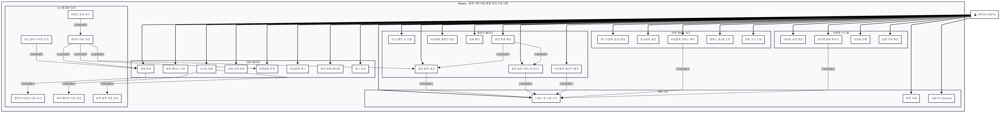
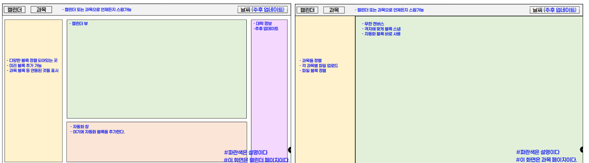
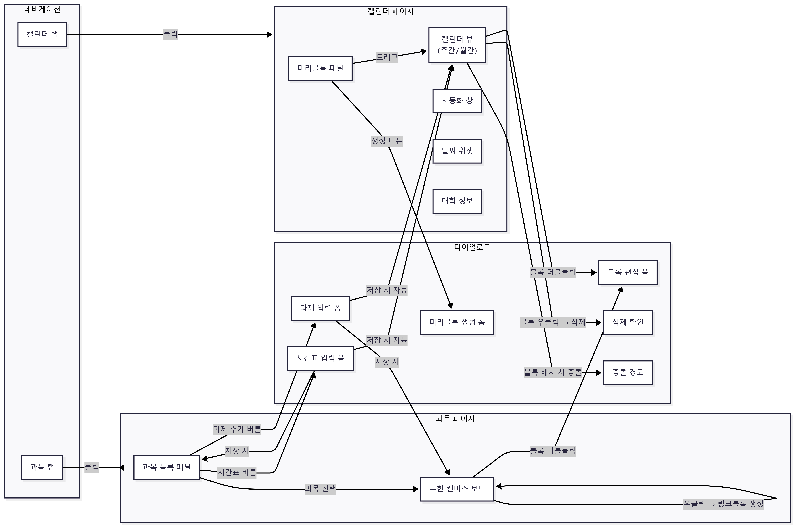
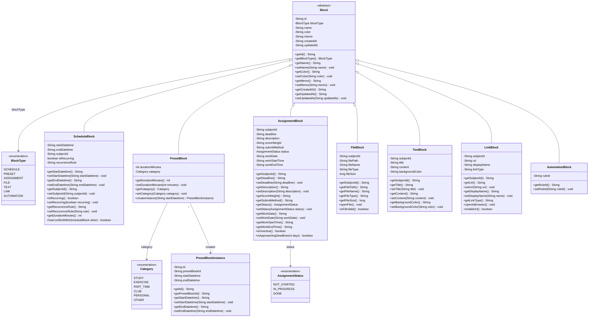

```mermaid
classDiagram
    direction TB

    %% ===== Subject 영역 =====
    class Semester {
        -String id
        -String name
        -String startDate
        -String endDate
        -boolean isActive
        -String createdAt
        +getId() String
        +getName() String
        +setName(String name) void
        +getStartDate() String
        +setStartDate(String startDate) void
        +getEndDate() String
        +setEndDate(String endDate) void
        +isActive() boolean
        +setActive(boolean active) void
        +getCreatedAt() String
    }

    class Subject {
        -String id
        -String semesterId
        -String name
        -String professor
        -String classroom
        -String color
        -int sortOrder
        -String createdAt
        +getId() String
        +getSemesterId() String
        +getName() String
        +setName(String name) void
        +getProfessor() String
        +setProfessor(String professor) void
        +getClassroom() String
        +setClassroom(String classroom) void
        +getColor() String
        +setColor(String color) void
        +getSortOrder() int
        +setSortOrder(int order) void
        +getCreatedAt() String
    }

    class Timetable {
        -String id
        -String subjectId
        -int dayOfWeek
        -String startTime
        -String endTime
        +getId() String
        +getSubjectId() String
        +getDayOfWeek() int
        +setDayOfWeek(int day) void
        +getStartTime() String
        +setStartTime(String time) void
        +getEndTime() String
        +setEndTime(String time) void
        +hasConflictWith(Timetable other) boolean
    }

    class Assignment {
        -String blockId
        -String subjectId
        -String deadline
        -String description
        -String scoreWeight
        -String submitMethod
        -AssignmentStatus status
        -String workDate
        -String workStartTime
        -String workEndTime
        +getBlockId() String
        +getSubjectId() String
        +getDeadline() String
        +setDeadline(String deadline) void
        +getDescription() String
        +setDescription(String desc) void
        +getStatus() AssignmentStatus
        +setStatus(AssignmentStatus status) void
        +getWorkDate() String
        +setWorkDate(String date) void
        +isOverdue() boolean
        +isApproachingDeadline(int days) boolean
    }

    class Tag {
        -String id
        -String name
        +getId() String
        +getName() String
        +setName(String name) void
    }

    class BlockTag {
        -String blockId
        -String tagId
        +getBlockId() String
        +getTagId() String
    }

    class SortPreference {
        -String id
        -String subjectId
        -String sortField
        -String sortDirection
        +getId() String
        +getSubjectId() String
        +getSortField() String
        +setSortField(String field) void
        +getSortDirection() String
        +setSortDirection(String direction) void
    }

    %% ===== Calendar 영역 =====
    class CalendarModel {
        -Semester currentSemester
        -ViewMode currentViewMode
        -String currentDate
        -List~ScheduleBlock~ scheduleBlocks
        -List~PresetBlockInstance~ presetInstances
        +getCurrentSemester() Semester
        +getCurrentViewMode() ViewMode
        +setCurrentViewMode(ViewMode mode) void
        +getCurrentDate() String
        +setCurrentDate(String date) void
        +getBlocksForDate(String date) List~ScheduleBlock~
        +getBlocksForWeek(String weekStart) List~ScheduleBlock~
        +getBlocksForMonth(int year, int month) List~ScheduleBlock~
        +addBlock(ScheduleBlock block) void
        +removeBlock(String blockId) void
        +detectConflicts(String date) List~ScheduleBlock~
    }

    class WeekViewModel {
        -String weekStartDate
        -String weekEndDate
        -List~TimeSlot~ timeSlots
        -List~ScheduleBlock~ weekBlocks
        +getWeekStartDate() String
        +getWeekEndDate() String
        +getTimeSlots() List~TimeSlot~
        +getWeekBlocks() List~ScheduleBlock~
        +getBlocksForDayAndTime(int day, String time) List~ScheduleBlock~
        +navigateNext() void
        +navigatePrev() void
    }

    class MonthViewModel {
        -int year
        -int month
        -List~ScheduleBlock~ monthBlocks
        +getYear() int
        +getMonth() int
        +getMonthBlocks() List~ScheduleBlock~
        +getBlocksForDate(String date) List~ScheduleBlock~
        +getDaysInMonth() int
        +getFirstDayOfWeek() int
        +navigateNext() void
        +navigatePrev() void
    }

    class TimeSlot {
        -String startTime
        -String endTime
        -int dayOfWeek
        -boolean isOccupied
        +getStartTime() String
        +getEndTime() String
        +getDayOfWeek() int
        +isOccupied() boolean
        +setOccupied(boolean occupied) void
    }

    class ViewMode {
        <<enumeration>>
        WEEK
        MONTH
    }

    %% ===== Canvas 상태 =====
    class CanvasState {
        -String id
        -String subjectId
        -String blockId
        -double posX
        -double posY
        -double width
        -double height
        -int zOrder
        +getId() String
        +getSubjectId() String
        +getBlockId() String
        +getPosX() double
        +setPosX(double x) void
        +getPosY() double
        +setPosY(double y) void
        +getWidth() double
        +setWidth(double w) void
        +getHeight() double
        +setHeight(double h) void
        +getZOrder() int
        +setZOrder(int order) void
    }

    %% ===== Automation 영역 =====
    class AutomationRule {
        -String id
        -String name
        -String context
        -String subjectId
        -boolean isActive
        -String createdAt
        -List~AutomationCommand~ commands
        +getId() String
        +getName() String
        +setName(String name) void
        +getContext() String
        +getSubjectId() String
        +isActive() boolean
        +setActive(boolean active) void
        +getCommands() List~AutomationCommand~
        +addCommand(AutomationCommand cmd) void
        +execute() ExecutionLog
    }

    class AutomationCommand {
        -String id
        -String ruleId
        -CommandType commandType
        -int sortOrder
        -List~CommandSlot~ slots
        +getId() String
        +getRuleId() String
        +getCommandType() CommandType
        +getSortOrder() int
        +getSlots() List~CommandSlot~
        +addSlot(CommandSlot slot) void
        +isComplete() boolean
    }

    class CommandSlot {
        -String id
        -String commandId
        -SlotType slotType
        -int slotOrder
        +getId() String
        +getCommandId() String
        +getSlotType() SlotType
        +getSlotOrder() int
        +isFilled() boolean
    }

    class SlotNextWeek {
        -String slotId
        -int weekOffset
        +getSlotId() String
        +getWeekOffset() int
        +setWeekOffset(int offset) void
        +calculateTargetDate() String
    }

    class SlotDayOfWeek {
        -String id
        -String slotId
        -int dayOfWeek
        +getId() String
        +getSlotId() String
        +getDayOfWeek() int
        +setDayOfWeek(int day) void
        +getDayName() String
    }

    class SlotPresetBlock {
        -String slotId
        -String presetBlockId
        +getSlotId() String
        +getPresetBlockId() String
        +setPresetBlockId(String id) void
    }

    class SlotOpenBlocks {
        -String id
        -String slotId
        -String blockId
        +getId() String
        +getSlotId() String
        +getBlockId() String
        +setBlockId(String id) void
    }

    class ExecutionLog {
        -String id
        -String ruleId
        -String executedAt
        -String status
        -String resultMessage
        +getId() String
        +getRuleId() String
        +getExecutedAt() String
        +getStatus() String
        +getResultMessage() String
    }

    class CommandType {
        <<enumeration>>
        REGISTER_SCHEDULE
        OPEN_BLOCKS
    }

    class SlotType {
        <<enumeration>>
        NEXT_WEEK
        DAY_OF_WEEK
        PRESET_BLOCK
        OPEN_BLOCKS
    }

    %% ===== Subject 영역 관계 =====
    Semester "1" --> "*" Subject : contains
    Subject "1" --> "*" Timetable : has
    Subject "1" --> "*" Assignment : has
    Subject "1" --> "*" SortPreference : has
    Subject "1" --> "*" CanvasState : has

    Tag "1" --> "*" BlockTag : referenced by
    BlockTag "*" --> "1" Tag : references

    %% ===== Calendar 영역 관계 =====
    CalendarModel --> ViewMode : currentViewMode
    CalendarModel --> Semester : currentSemester
    CalendarModel "1" --> "1" WeekViewModel : weekView
    CalendarModel "1" --> "1" MonthViewModel : monthView
    WeekViewModel "1" --> "*" TimeSlot : contains

    %% ===== Automation 영역 관계 =====
    AutomationRule "1" --> "*" AutomationCommand : contains
    AutomationRule --> Subject : references
    AutomationRule "1" --> "*" ExecutionLog : generates
    AutomationCommand "1" --> "*" CommandSlot : contains
    AutomationCommand --> CommandType : commandType
    CommandSlot --> SlotType : slotType
    CommandSlot "1" --> "0..1" SlotNextWeek : value
    CommandSlot "1" --> "*" SlotDayOfWeek : value
    CommandSlot "1" --> "0..1" SlotPresetBlock : value
    CommandSlot "1" --> "*" SlotOpenBlocks : value
```

```mermaid
classDiagram
    direction TB

    %% ===== Service 클래스 =====
    class CalendarService {
        -CalendarModel calendarModel
        -ScheduleBlockDAO scheduleBlockDAO
        -PresetBlockInstanceDAO presetBlockInstanceDAO
        +getBlocksForDate(String date) List~ScheduleBlock~
        +getBlocksForWeek(String weekStart) List~ScheduleBlock~
        +getBlocksForMonth(int year, int month) List~ScheduleBlock~
        +addScheduleBlock(ScheduleBlock block) void
        +moveBlock(String blockId, String newStart, String newEnd) void
        +resizeBlock(String blockId, String newEnd) void
        +removeBlock(String blockId) void
        +detectConflicts(ScheduleBlock block) List~ScheduleBlock~
        +switchViewMode(ViewMode mode) void
        +navigateNext() void
        +navigatePrev() void
        +addDeadlineMark(String date, String assignmentId) void
        +removeDeadlineMark(String assignmentId) void
    }

    class BlockService {
        -BlockDAO blockDAO
        +createBlock(BlockType type, String name, String color) Block
        +updateBlock(Block block) void
        +deleteBlock(String blockId) void
        +getBlockById(String blockId) Block
        +getBlocksByType(BlockType type) List~Block~
        +getBlocksBySubject(String subjectId) List~Block~
        +duplicateBlock(String blockId) Block
        +updateTimestamp(String blockId) void
    }

    class SubjectService {
        -SubjectDAO subjectDAO
        -SemesterDAO semesterDAO
        -SortPreferenceDAO sortPreferenceDAO
        +createSubject(String name, String professor, String classroom, String color) Subject
        +updateSubject(Subject subject) void
        +deleteSubject(String subjectId) void
        +getSubjectById(String subjectId) Subject
        +getSubjectsBySemester(String semesterId) List~Subject~
        +createSemester(String name, String startDate, String endDate) Semester
        +setActiveSemester(String semesterId) void
        +getActiveSemester() Semester
        +saveSortPreference(String subjectId, String field, String direction) void
        +getSortPreference(String subjectId) SortPreference
    }

    class AssignmentService {
        -AssignmentDAO assignmentDAO
        -CalendarService calendarService
        -BlockService blockService
        +createAssignment(String subjectId, String name, String deadline, String description) Assignment
        +updateAssignment(Assignment assignment) void
        +deleteAssignment(String blockId) void
        +updateStatus(String blockId, AssignmentStatus status) void
        +setWorkSchedule(String blockId, String workDate, String startTime, String endTime) void
        +getAssignmentsBySubject(String subjectId) List~Assignment~
        +getApproachingDeadlines(int withinDays) List~Assignment~
        +getOverdueAssignments() List~Assignment~
        +syncDeadlineToCalendar(String blockId, String deadline) void
        +removeCalendarSync(String blockId) void
    }

    class TimetableService {
        -TimetableDAO timetableDAO
        -SubjectService subjectService
        -CalendarService calendarService
        +addTimetableEntry(String subjectId, int dayOfWeek, String startTime, String endTime) Timetable
        +updateTimetableEntry(Timetable entry) void
        +deleteTimetableEntry(String entryId) void
        +getTimetableBySubject(String subjectId) List~Timetable~
        +getTimetableBySemester(String semesterId) List~Timetable~
        +detectConflict(Timetable entry) List~Timetable~
        +syncToCalendarAsRecurring(Timetable entry) void
        +removeRecurringFromCalendar(String entryId) void
        +generateWeeklyView(String semesterId) Map
    }

    class FileBlockService {
        -FileBlockDAO fileBlockDAO
        -BlockService blockService
        -TagDAO tagDAO
        +createFileBlock(String subjectId, String filePath) FileBlock
        +deleteFileBlock(String blockId) void
        +openFile(String blockId) void
        +isFileValid(String blockId) boolean
        +getFileBlocksBySubject(String subjectId) List~FileBlock~
        +getFileBlocksByTag(String tagName) List~FileBlock~
        +addTag(String blockId, String tagName) void
        +removeTag(String blockId, String tagId) void
        +getFileSize(String blockId) long
        +getSupportedFileTypes() List~String~
        +validateFileType(String filePath) boolean
    }

    class AutomationService {
        -AutomationRuleDAO automationRuleDAO
        -AutomationCommandDAO automationCommandDAO
        -CommandSlotDAO commandSlotDAO
        -ExecutionLogDAO executionLogDAO
        -CalendarService calendarService
        -FileBlockService fileBlockService
        +createRule(String name, String context, String subjectId) AutomationRule
        +updateRule(AutomationRule rule) void
        +deleteRule(String ruleId) void
        +activateRule(String ruleId) void
        +deactivateRule(String ruleId) void
        +addCommand(String ruleId, CommandType type) AutomationCommand
        +fillSlot(String slotId, SlotType type, Object value) void
        +executeRule(String ruleId) ExecutionLog
        +executeRegisterSchedule(AutomationCommand cmd) void
        +executeOpenBlocks(AutomationCommand cmd) void
        +isRuleComplete(String ruleId) boolean
        +getExecutionHistory(String ruleId) List~ExecutionLog~
        +getRulesByContext(String context) List~AutomationRule~
    }

    class DragDropService {
        -CalendarService calendarService
        -BlockService blockService
        +validateDrop(String blockId, String targetArea, Object position) boolean
        +validateCalendarDrop(String blockId, String datetime) boolean
        +validateCanvasDrop(String blockId, double x, double y) boolean
        +processCalendarDrop(String blockId, String startDatetime) void
        +processPresetDrop(String presetBlockId, String startDatetime) PresetBlockInstance
        +processAssignmentDrop(String assignmentBlockId, String workDate) void
        +processCanvasDrop(String blockId, double posX, double posY) void
        +revertDrop(String blockId) void
    }

    class WeatherService {
        <<future>>
        +getTomorrowWeather(String location) WeatherInfo
        +formatWeatherDisplay(WeatherInfo info) String
    }

    %% ===== 공통 유틸 =====
    class AutoSaveManager {
        -int saveIntervalMs
        -boolean isDirty
        +markDirty() void
        +save() void
        +startAutoSave() void
        +stopAutoSave() void
        +recoverLastState() void
    }

    class EventBus {
        -Map~String, List~ listeners
        +subscribe(String event, EventListener listener) void
        +unsubscribe(String event, EventListener listener) void
        +publish(String event, Object data) void
    }

    %% ===== Service 간 의존 관계 =====
    AssignmentService --> CalendarService : 마감일 연동
    AssignmentService --> BlockService : 블록 생성/삭제

    TimetableService --> SubjectService : 과목 조회
    TimetableService --> CalendarService : 반복 블록 생성

    FileBlockService --> BlockService : 블록 생성/삭제

    AutomationService --> CalendarService : 일정 등록 실행
    AutomationService --> FileBlockService : 블록 열기 실행

    DragDropService --> CalendarService : 캘린더 드롭 처리
    DragDropService --> BlockService : 블록 조회/이동

    %% ===== EventBus 연결 =====
    CalendarService --> EventBus : publish(블록 변경)
    BlockService --> EventBus : publish(블록 CRUD)
    SubjectService --> EventBus : publish(과목 변경)
    AssignmentService --> EventBus : publish(과제 상태 변경)
    AutomationService --> EventBus : publish(자동화 실행)

    %% ===== AutoSaveManager 연결 =====
    CalendarService --> AutoSaveManager : markDirty
    BlockService --> AutoSaveManager : markDirty
    SubjectService --> AutoSaveManager : markDirty
```

```mermaid
classDiagram
    direction TB

    %% ===== 메인 프레임 =====
    class MainFrame {
        -NavigationPanel navigationPanel
        -CalendarPagePanel calendarPagePanel
        -SubjectPagePanel subjectPagePanel
        -JPanel contentPanel
        +MainFrame()
        +switchToCalendarPage() void
        +switchToSubjectPage() void
        +showDialog(JDialog dialog) void
        +getContentPanel() JPanel
    }

    class NavigationPanel {
        -JButton calendarTabButton
        -JButton subjectTabButton
        -JLabel appTitle
        +NavigationPanel()
        +setActiveTab(String tabName) void
        +onCalendarTabClick(ActionListener listener) void
        +onSubjectTabClick(ActionListener listener) void
    }

    %% ===== 캘린더 페이지 UI =====
    class CalendarPagePanel {
        -CalendarGridPanel calendarGrid
        -PresetBlockPanel presetPanel
        -WeatherWidget weatherWidget
        -JButton viewToggleButton
        -JButton automationButton
        -JButton prevButton
        -JButton nextButton
        -JLabel dateLabel
        +CalendarPagePanel()
        +switchView(ViewMode mode) void
        +refreshCalendar() void
        +updateDateLabel(String dateText) void
        +showAutomationPanel() void
    }

    class CalendarGridPanel {
        -WeekViewPanel weekViewPanel
        -MonthViewPanel monthViewPanel
        -ViewMode currentMode
        +CalendarGridPanel()
        +setViewMode(ViewMode mode) void
        +refresh(List~ScheduleBlock~ blocks) void
        +highlightConflicts(List~ScheduleBlock~ conflicts) void
        +getCurrentMode() ViewMode
    }

    class WeekViewPanel {
        -List~BlockRenderer~ blockRenderers
        -String[] dayHeaders
        -String[] timeLabels
        -int cellWidth
        -int cellHeight
        +WeekViewPanel()
        +renderBlocks(List~ScheduleBlock~ blocks) void
        +paintGrid(Graphics g) void
        +getTimeSlotAt(int x, int y) TimeSlot
        +highlightTimeSlot(int day, String time) void
        +clearHighlight() void
    }

    class MonthViewPanel {
        -int year
        -int month
        -JPanel[][] dayCells
        -List~BlockRenderer~ blockRenderers
        +MonthViewPanel()
        +renderMonth(int year, int month, List~ScheduleBlock~ blocks) void
        +paintDayCells(Graphics g) void
        +getDateAt(int x, int y) String
        +highlightDate(String date) void
        +showDeadlineMark(String date, String label) void
    }

    class PresetBlockPanel {
        -List~DraggableComponent~ presetItems
        -JButton createPresetButton
        -JPanel listPanel
        -JScrollPane scrollPane
        +PresetBlockPanel()
        +refreshPresetList(List~PresetBlock~ presets) void
        +addPresetItem(PresetBlock preset) void
        +removePresetItem(String presetBlockId) void
        +showEmptyGuide() void
        +onCreatePresetClick(ActionListener listener) void
    }

    class BlockRenderer {
        -Block block
        -int x
        -int y
        -int width
        -int height
        -boolean isSelected
        -boolean isDragging
        -float opacity
        +BlockRenderer(Block block)
        +paint(Graphics2D g) void
        +paintScheduleBlock(Graphics2D g) void
        +paintAssignmentBlock(Graphics2D g) void
        +paintDeadlineMark(Graphics2D g) void
        +contains(int px, int py) boolean
        +setSelected(boolean selected) void
        +setDragging(boolean dragging) void
        +setOpacity(float opacity) void
        +getBounds() Rectangle
    }

    class AutomationPanel {
        -JPanel commandArea
        -JPanel slotPanel
        -JButton executeButton
        -JList~AutomationRule~ ruleList
        +AutomationPanel()
        +showRules(List~AutomationRule~ rules) void
        +renderCommandSlots(AutomationCommand cmd) void
        +highlightEmptySlots() void
        +onExecuteClick(ActionListener listener) void
        +showExecutionResult(ExecutionLog log) void
    }

    class WeatherWidget {
        -JLabel weatherIcon
        -JLabel temperatureLabel
        -JLabel descriptionLabel
        +WeatherWidget()
        +updateWeather(String icon, String temp, String desc) void
        +showLoading() void
        +showError(String message) void
    }

    %% ===== 과목 페이지 UI =====
    class SubjectPagePanel {
        -SubjectListPanel subjectListPanel
        -SubjectDetailPanel subjectDetailPanel
        -JSplitPane splitPane
        +SubjectPagePanel()
        +refreshSubjectList(List~Subject~ subjects) void
        +showSubjectDetail(String subjectId) void
        +showTimetableInput() void
        +showAssignmentInput(String subjectId) void
    }

    class SubjectListPanel {
        -JList~Subject~ subjectList
        -JButton timetableButton
        -JScrollPane scrollPane
        -DefaultListModel~Subject~ listModel
        +SubjectListPanel()
        +setSubjects(List~Subject~ subjects) void
        +getSelectedSubject() Subject
        +onSubjectSelect(ListSelectionListener listener) void
        +onTimetableClick(ActionListener listener) void
        +highlightSubject(String subjectId) void
    }

    class SubjectDetailPanel {
        -InfiniteCanvasPanel canvasPanel
        -FileBlockListPanel fileBlockListPanel
        -SubjectSortPanel sortPanel
        -JButton assignmentAddButton
        -JButton openCanvasButton
        -JTabbedPane tabPane
        +SubjectDetailPanel()
        +loadSubjectData(String subjectId) void
        +refreshFileBlocks(List~FileBlock~ files) void
        +refreshAssignments(List~Assignment~ assignments) void
        +showCanvas() void
        +onAssignmentAddClick(ActionListener listener) void
    }

    class FileBlockListPanel {
        -List~DraggableComponent~ fileBlockItems
        -JComboBox~String~ filterCombo
        -JPanel listPanel
        -JScrollPane scrollPane
        +FileBlockListPanel()
        +setFileBlocks(List~FileBlock~ fileBlocks) void
        +filterByTag(String tagName) void
        +sortBy(String field, String direction) void
        +onFileBlockDoubleClick(MouseListener listener) void
        +showFileInvalidWarning(String blockId) void
    }

    class SubjectSortPanel {
        -JComboBox~String~ sortFieldCombo
        -JToggleButton sortDirectionButton
        +SubjectSortPanel()
        +getSortField() String
        +getSortDirection() String
        +onSortChange(ActionListener listener) void
        +setSortState(String field, String direction) void
    }

    class AssignmentInputDialog {
        -JTextField nameField
        -JSpinner deadlinePicker
        -JTextArea descriptionArea
        -JTextField scoreWeightField
        -JComboBox~String~ submitMethodCombo
        -JButton fileAttachButton
        -JButton saveButton
        -JButton cancelButton
        +AssignmentInputDialog(JFrame parent)
        +getAssignmentName() String
        +getDeadline() String
        +getDescription() String
        +getScoreWeight() String
        +getSubmitMethod() String
        +getAttachedFiles() List~File~
        +onSave(ActionListener listener) void
        +showValidationError(String message) void
        +clear() void
    }

    class TimetableInputDialog {
        -JTextField subjectNameField
        -JTextField professorField
        -JTextField classroomField
        -JComboBox~String~ dayCombo
        -JSpinner startTimePicker
        -JSpinner endTimePicker
        -ColorPicker colorPicker
        -JButton addButton
        -JButton closeButton
        -JTable timetableGrid
        +TimetableInputDialog(JFrame parent)
        +getSubjectName() String
        +getProfessor() String
        +getClassroom() String
        +getDayOfWeek() int
        +getStartTime() String
        +getEndTime() String
        +getSelectedColor() String
        +onAdd(ActionListener listener) void
        +showConflictWarning(String message) void
        +refreshTimetableGrid(List~Timetable~ entries) void
    }

    %% ===== 무한 캔버스 보드 UI =====
    class InfiniteCanvasPanel {
        -CanvasViewport viewport
        -GridRenderer gridRenderer
        -List~CanvasBlockComponent~ blockComponents
        -double zoomLevel
        -double panX
        -double panY
        +InfiniteCanvasPanel()
        +addBlockComponent(CanvasBlockComponent comp) void
        +removeBlockComponent(String blockId) void
        +zoomIn() void
        +zoomOut() void
        +resetZoom() void
        +panTo(double x, double y) void
        +getBlockComponentAt(int x, int y) CanvasBlockComponent
        +refreshAll() void
        +saveState() void
    }

    class CanvasViewport {
        -double offsetX
        -double offsetY
        -double scale
        -int viewWidth
        -int viewHeight
        +CanvasViewport()
        +screenToWorld(int sx, int sy) Point2D
        +worldToScreen(double wx, double wy) Point
        +setScale(double scale) void
        +getScale() double
        +pan(double dx, double dy) void
        +getVisibleBounds() Rectangle2D
    }

    class GridRenderer {
        -int gridSize
        -Color gridColor
        -boolean showGrid
        +GridRenderer()
        +paintGrid(Graphics2D g, CanvasViewport viewport) void
        +snapToGrid(double x, double y) Point2D
        +setGridSize(int size) void
        +setShowGrid(boolean show) void
    }

    class CanvasBlockComponent {
        -String blockId
        -double posX
        -double posY
        -double width
        -double height
        -boolean isSelected
        -boolean isResizing
        +CanvasBlockComponent(String blockId)
        +paint(Graphics2D g) void
        +setPosition(double x, double y) void
        +setSize(double w, double h) void
        +contains(double x, double y) boolean
        +getResizeHandle(double x, double y) int
        +setSelected(boolean selected) void
        +getBounds() Rectangle2D
    }

    class TextBlockComponent {
        -JTextArea textArea
        -String title
        -String content
        -Color backgroundColor
        -boolean isEditing
        +TextBlockComponent(String blockId)
        +paint(Graphics2D g) void
        +enterEditMode() void
        +exitEditMode() void
        +getTitle() String
        +getContent() String
        +setBackgroundColor(Color color) void
    }

    class LinkBlockComponent {
        -String url
        -String displayName
        -Icon faviconIcon
        -JLabel linkLabel
        +LinkBlockComponent(String blockId)
        +paint(Graphics2D g) void
        +setUrl(String url) void
        +setDisplayName(String name) void
        +setFavicon(Icon icon) void
        +openLink() void
    }

    class FileBlockComponent {
        -String fileName
        -String fileType
        -Icon fileTypeIcon
        -JLabel fileNameLabel
        +FileBlockComponent(String blockId)
        +paint(Graphics2D g) void
        +setFileName(String name) void
        +setFileType(String type) void
        +openFile() void
        +showFileNotFound() void
    }

    %% ===== 공통 다이얼로그 =====
    class BlockEditDialog {
        -JTextField nameField
        -ColorPicker colorPicker
        -JTextArea memoArea
        -JButton saveButton
        -JButton deleteButton
        -JButton cancelButton
        +BlockEditDialog(JFrame parent, Block block)
        +getBlockName() String
        +getColor() String
        +getMemo() String
        +onSave(ActionListener listener) void
        +onDelete(ActionListener listener) void
    }

    class PresetBlockCreateDialog {
        -JTextField nameField
        -JSpinner durationSpinner
        -ColorPicker colorPicker
        -JComboBox~Category~ categoryCombo
        -JButton createButton
        -JButton cancelButton
        +PresetBlockCreateDialog(JFrame parent)
        +getPresetName() String
        +getDuration() int
        +getColor() String
        +getCategory() Category
        +onCreate(ActionListener listener) void
        +showDuplicateNameError() void
    }

    class ConfirmDeleteDialog {
        -String message
        -JButton confirmButton
        -JButton cancelButton
        +ConfirmDeleteDialog(JFrame parent, String message)
        +onConfirm(ActionListener listener) void
        +isConfirmed() boolean
    }

    class ConflictWarningDialog {
        -List~ScheduleBlock~ conflicts
        -JPanel conflictListPanel
        -JButton proceedButton
        -JButton cancelButton
        +ConflictWarningDialog(JFrame parent, List~ScheduleBlock~ conflicts)
        +showConflicts() void
        +onProceed(ActionListener listener) void
    }

    %% ===== 재사용 컴포넌트 =====
    class ColorPicker {
        -Color selectedColor
        -List~Color~ colorPalette
        -JPanel colorGrid
        +ColorPicker()
        +getSelectedColor() Color
        +setSelectedColor(Color color) void
        +onColorSelect(ActionListener listener) void
    }

    class TagChip {
        -String tagName
        -JLabel label
        -JButton removeButton
        +TagChip(String tagName)
        +getTagName() String
        +onRemove(ActionListener listener) void
        +setRemovable(boolean removable) void
    }

    class StatusBadge {
        -AssignmentStatus status
        -Color badgeColor
        -JLabel statusLabel
        +StatusBadge(AssignmentStatus status)
        +setStatus(AssignmentStatus status) void
        +getStatus() AssignmentStatus
    }

    class DraggableComponent {
        -boolean isDraggable
        -boolean isDragging
        -Point dragOffset
        -float dragOpacity
        +DraggableComponent()
        +setDraggable(boolean draggable) void
        +isDragging() boolean
        +startDrag(Point startPoint) void
        +updateDrag(Point currentPoint) void
        +endDrag(Point dropPoint) void
        +paintDragGhost(Graphics2D g) void
    }

    %% ===== 컴포지션 관계: 메인 프레임 =====
    MainFrame "1" *-- "1" NavigationPanel
    MainFrame "1" *-- "1" CalendarPagePanel
    MainFrame "1" *-- "1" SubjectPagePanel

    %% ===== 컴포지션 관계: 캘린더 페이지 =====
    CalendarPagePanel "1" *-- "1" CalendarGridPanel
    CalendarPagePanel "1" *-- "1" PresetBlockPanel
    CalendarPagePanel "1" *-- "1" WeatherWidget
    CalendarPagePanel "1" *-- "1" AutomationPanel
    CalendarGridPanel "1" *-- "1" WeekViewPanel
    CalendarGridPanel "1" *-- "1" MonthViewPanel
    WeekViewPanel "1" *-- "*" BlockRenderer
    MonthViewPanel "1" *-- "*" BlockRenderer

    %% ===== 컴포지션 관계: 과목 페이지 =====
    SubjectPagePanel "1" *-- "1" SubjectListPanel
    SubjectPagePanel "1" *-- "1" SubjectDetailPanel
    SubjectDetailPanel "1" *-- "1" InfiniteCanvasPanel
    SubjectDetailPanel "1" *-- "1" FileBlockListPanel
    SubjectDetailPanel "1" *-- "1" SubjectSortPanel

    %% ===== 컴포지션 관계: 캔버스 =====
    InfiniteCanvasPanel "1" *-- "1" CanvasViewport
    InfiniteCanvasPanel "1" *-- "1" GridRenderer
    InfiniteCanvasPanel "1" *-- "*" CanvasBlockComponent
    CanvasBlockComponent <|-- TextBlockComponent
    CanvasBlockComponent <|-- LinkBlockComponent
    CanvasBlockComponent <|-- FileBlockComponent

    %% ===== 재사용 컴포넌트 사용 =====
    PresetBlockPanel "1" *-- "*" DraggableComponent
    FileBlockListPanel "1" *-- "*" DraggableComponent
    FileBlockListPanel "1" *-- "*" TagChip
    SubjectDetailPanel "1" *-- "*" StatusBadge
    BlockEditDialog "1" *-- "1" ColorPicker
    PresetBlockCreateDialog "1" *-- "1" ColorPicker
    TimetableInputDialog "1" *-- "1" ColorPicker
```

```mermaid
classDiagram
    direction TB

    %% ===== Controller 클래스 =====
    class CalendarController {
        -CalendarService calendarService
        -BlockService blockService
        -CalendarPagePanel calendarPagePanel
        -CalendarGridPanel calendarGridPanel
        +CalendarController(CalendarService, BlockService, CalendarPagePanel)
        +initialize() void
        +onViewModeToggle(ViewMode mode) void
        +onNavigateNext() void
        +onNavigatePrev() void
        +onTimeSlotClick(int day, String time) void
        +onTimeSlotDrag(int day, String startTime, String endTime) void
        +onBlockClick(String blockId) void
        +onBlockDoubleClick(String blockId) void
        +onBlockRightClick(String blockId, int x, int y) void
        +onBlockMove(String blockId, String newStart, String newEnd) void
        +onBlockResize(String blockId, String newEnd) void
        +onBlockDelete(String blockId) void
        +onAutomationButtonClick() void
        +refreshView() void
        -showBlockEditDialog(String blockId) void
        -showContextMenu(String blockId, int x, int y) void
        -handleConflict(List~ScheduleBlock~ conflicts) void
    }

    class SubjectController {
        -SubjectService subjectService
        -AssignmentService assignmentService
        -FileBlockService fileBlockService
        -SubjectPagePanel subjectPagePanel
        +SubjectController(SubjectService, AssignmentService, FileBlockService, SubjectPagePanel)
        +initialize() void
        +onSubjectSelect(String subjectId) void
        +onTimetableButtonClick() void
        +onAssignmentAddClick(String subjectId) void
        +onFileBlockAdd(String subjectId) void
        +onFileBlockDoubleClick(String blockId) void
        +onFileBlockRightClick(String blockId, int x, int y) void
        +onSortChange(String field, String direction) void
        +onFilterByTag(String tagName) void
        +onAssignmentStatusChange(String blockId, AssignmentStatus status) void
        +refreshSubjectList() void
        +refreshSubjectDetail(String subjectId) void
        -showAssignmentInputDialog(String subjectId) void
        -showTimetableInputDialog() void
        -showFileChooser(String subjectId) void
        -validateFileType(String filePath) boolean
    }

    class CanvasController {
        -BlockService blockService
        -FileBlockService fileBlockService
        -InfiniteCanvasPanel canvasPanel
        -CanvasStateDAO canvasStateDAO
        +CanvasController(BlockService, FileBlockService, InfiniteCanvasPanel)
        +initialize() void
        +onCanvasClick(double worldX, double worldY) void
        +onCanvasRightClick(double worldX, double worldY) void
        +onBlockSelect(String blockId) void
        +onBlockMove(String blockId, double newX, double newY) void
        +onBlockResize(String blockId, double newW, double newH) void
        +onBlockDoubleClick(String blockId) void
        +onBlockDelete(String blockId) void
        +onZoomIn() void
        +onZoomOut() void
        +onPan(double dx, double dy) void
        +onTextBlockCreate(double x, double y) void
        +onLinkBlockCreate(double x, double y, String url) void
        +saveCanvasState() void
        +loadCanvasState(String subjectId) void
        -showContextMenu(double x, double y) void
        -snapToGrid(double x, double y) Point2D
    }

    class DragDropController {
        -DragDropService dragDropService
        -CalendarController calendarController
        -CanvasController canvasController
        -BlockDragSource blockDragSource
        -CalendarDropTarget calendarDropTarget
        -CanvasDropTarget canvasDropTarget
        -DragGhostPanel dragGhostPanel
        +DragDropController(DragDropService, CalendarController, CanvasController)
        +initialize() void
        +onDragStart(String blockId, Point startPoint) void
        +onDragUpdate(Point currentPoint) void
        +onDragEnd(Point dropPoint) void
        +onPresetBlockDragToCalendar(String presetBlockId, String datetime) void
        +onAssignmentDragToCalendar(String assignmentBlockId, String workDate) void
        +onFileBlockDragToCanvas(String fileBlockId, double x, double y) void
        +onCalendarBlockMove(String blockId, String newDatetime) void
        +onAutomationSlotDrop(String slotId, String blockId) void
        +cancelDrag() void
        -identifyDropTarget(Point point) String
        -showDropFeedback(String targetArea, Point point) void
        -hideDropFeedback() void
        -revertToOriginalPosition(String blockId) void
    }

    class AutomationController {
        -AutomationService automationService
        -AutomationPanel automationPanel
        -DragDropController dragDropController
        +AutomationController(AutomationService, AutomationPanel)
        +initialize() void
        +onRuleCreate(String name, String context) void
        +onRuleSelect(String ruleId) void
        +onRuleDelete(String ruleId) void
        +onRuleActivate(String ruleId) void
        +onRuleDeactivate(String ruleId) void
        +onCommandAdd(String ruleId, CommandType type) void
        +onSlotFill(String slotId, SlotType type, Object value) void
        +onSlotClear(String slotId) void
        +onExecuteClick(String ruleId) void
        +refreshRuleList(String context) void
        +refreshCommandView(String ruleId) void
        -validateRuleComplete(String ruleId) boolean
        -showExecutionResult(ExecutionLog log) void
        -highlightIncompleteSlots(String ruleId) void
    }

    class TimetableController {
        -TimetableService timetableService
        -SubjectService subjectService
        -TimetableInputDialog timetableDialog
        +TimetableController(TimetableService, SubjectService)
        +initialize() void
        +onEntryAdd(String subjectName, String professor, String classroom, int day, String startTime, String endTime, String color) void
        +onEntryUpdate(String entryId, Timetable updated) void
        +onEntryDelete(String entryId) void
        +onDialogOpen() void
        +onDialogClose() void
        +refreshTimetableGrid() void
        -validateEntry(int day, String startTime, String endTime) boolean
        -handleConflict(List~Timetable~ conflicts) void
        -createSubjectFromEntry(String name, String professor, String classroom, String color) Subject
    }

    %% ===== DnD 시스템 클래스 =====
    class BlockTransferable {
        -String blockId
        -BlockType blockType
        -DataFlavor blockFlavor
        +BlockTransferable(String blockId, BlockType blockType)
        +getTransferDataFlavors() DataFlavor[]
        +isDataFlavorSupported(DataFlavor flavor) boolean
        +getTransferData(DataFlavor flavor) Object
        +getBlockId() String
        +getBlockType() BlockType
        +getBlockFlavor() DataFlavor
    }

    class BlockDragSource {
        -DragSource dragSource
        -DragDropController controller
        -Component sourceComponent
        -String currentBlockId
        -Point dragOrigin
        +BlockDragSource(DragDropController controller)
        +registerComponent(Component comp, String blockId) void
        +unregisterComponent(Component comp) void
        +startDrag(Component comp, MouseEvent e) void
        +getDragOrigin() Point
        +getCurrentBlockId() String
        -createDragGestureListener() DragGestureListener
        -createDragSourceListener() DragSourceListener
    }

    class CalendarDropTarget {
        -DropTarget dropTarget
        -DragDropController controller
        -CalendarGridPanel calendarGrid
        -String highlightedSlot
        +CalendarDropTarget(DragDropController controller, CalendarGridPanel grid)
        +register() void
        +unregister() void
        +getDatetimeAtPoint(Point point) String
        +isValidDropLocation(Point point, BlockType type) boolean
        +showDropHighlight(Point point) void
        +hideDropHighlight() void
        -createDropTargetListener() DropTargetListener
        -calculateTimeSlot(Point point) String
    }

    class CanvasDropTarget {
        -DropTarget dropTarget
        -DragDropController controller
        -InfiniteCanvasPanel canvasPanel
        -Point2D highlightedPosition
        +CanvasDropTarget(DragDropController controller, InfiniteCanvasPanel canvas)
        +register() void
        +unregister() void
        +getWorldPositionAtPoint(Point point) Point2D
        +isValidDropLocation(Point point, BlockType type) boolean
        +showDropHighlight(Point point) void
        +hideDropHighlight() void
        +getSnappedPosition(Point point) Point2D
        -createDropTargetListener() DropTargetListener
    }

    class DragGhostPanel {
        -JPanel ghostPanel
        -Block draggedBlock
        -float opacity
        -Point currentPosition
        -int ghostWidth
        -int ghostHeight
        +DragGhostPanel()
        +showGhost(Block block, Point position) void
        +updatePosition(Point position) void
        +hideGhost() void
        +setOpacity(float opacity) void
        +paint(Graphics2D g) void
        -renderBlockPreview(Graphics2D g, Block block) void
    }

    %% ===== Controller → Service 의존 =====
    CalendarController --> CalendarService : delegates
    CalendarController --> BlockService : delegates
    SubjectController --> SubjectService : delegates
    SubjectController --> AssignmentService : delegates
    SubjectController --> FileBlockService : delegates
    CanvasController --> BlockService : delegates
    CanvasController --> FileBlockService : delegates
    DragDropController --> DragDropService : delegates
    AutomationController --> AutomationService : delegates
    TimetableController --> TimetableService : delegates
    TimetableController --> SubjectService : delegates

    %% ===== Controller → View 참조 =====
    CalendarController --> CalendarPagePanel : updates
    SubjectController --> SubjectPagePanel : updates
    CanvasController --> InfiniteCanvasPanel : updates
    AutomationController --> AutomationPanel : updates
    TimetableController --> TimetableInputDialog : updates

    %% ===== Controller 간 협력 =====
    DragDropController --> CalendarController : notifies drop
    DragDropController --> CanvasController : notifies drop
    AutomationController --> DragDropController : slot drag

    %% ===== DnD 시스템 관계 =====
    DragDropController "1" *-- "1" BlockDragSource
    DragDropController "1" *-- "1" CalendarDropTarget
    DragDropController "1" *-- "1" CanvasDropTarget
    DragDropController "1" *-- "1" DragGhostPanel
    BlockDragSource --> BlockTransferable : creates
    CalendarDropTarget --> BlockTransferable : receives
    CanvasDropTarget --> BlockTransferable : receives
```

# 자바 프로그래밍 기말 프로젝트

## #2 프로젝트 구조 및 역할 일정 관리 계획 


| 항목 |     내용     |
|:----:|:----------:|
| **과목명** |   자바프로그래밍  |
| **학과** |   정보통신공학과  |
| **학번** |  20220540  |
| **이름** |     김가온    |
| **생성일** | 2026.05.13 |
>  [!TIP]
>**프로젝트 전체 자료 모음 (단계별 AI 사용내역) : https://noctis-03.github.io/FinalJavaProject/**


<br>

---


##  <0. 목차>

- [1. 프로젝트 구조 설계](#1-프로젝트-구조-설계)
    - 1.1  프로젝트 기능 / 화면 / 시스템 구조 정리
      - 1.1.1 유스케이스 다이어그램
      - 1.1.2 유스케이스 상세 내용 정리
      - 1.1.3 화면 구성 정리
      - 1.1.4 데이터 베이스 스키마
        
    - 1.2 프로젝트 디렉터리 구조
    - 1.3 자바 클래스 다이어그램
      - 1.3.1 통합 클래스 개요 다이어그램
      - 1.3.2 계층(모델)별 클래스 다이어그램

<br>    
  
- [2. 역할 분담](2-역할-분담)
    - 2.1 팀원별 담당 업무와 책입 범위 작성
    - 2.2 협업 및 의사소통 방안 정리

<br>

- [3. 일정 관리 계획](3-일정-관리-계획)
    - 3.1 주체별 세부 일정 

<br>

---


## <1. 프로젝트 구조 설계>

### 1.1 프로젝트의 기능/화면/시스템 구조 정리  


- **1.1.1 유스케이스 다이어그램**
  
  
  >- 유스케이스다이어그램은 **사용자와 시스템이 제공하는 기능간의 관계**를 표현한다.  
  >- 이를 사용하여 프로젝트의 기능과 시스템 구조를 정리하고자 한다.  
  
  >- 위의 사진의 우클릭해 새 탭에서 이미지열기로 크게 볼 수 있다.  


<br>

  - **1.1.2 유스케이스 상세 내용 정리**  
    >- 본 프로젝트의 엑터는 대학생이다
    >- **유스케이스는 캘린더 페이지, 과목 페이지, 무한 캔버스 보드, 자동화 시스템, 공통 기능의 5개 영역**으로 분류된다.  
    >- 사용자가 직접 실행하지 않지만 특정 유스케이스의 결과로 시스템이 자동 수행하는 동작은 **SYS(시스템 내부 동작)** 로 별도 구분하였다.  
    
    >- **include 관계**는 **기본 유스케이스가 실행될 때 반드시 포함되어 실행되는 다른 유스케이스**를 나타낸다.  
    >- **extend 관계**는 **특정 조건이 충족될 때만 기본 유스케이스에 추가적으로 실행되는 유스케이스**를 나타낸다.  

      <details>
      
      <summary> 유스케이스 목록 </summary>   
      
    >  | ID    | 유스케이스명        | 관련 FR               | 영역     |
    >  |-------|---------------|---------------------|--------|
    >  | UC-01 | 일정 블록 생성      | FR-01               | 캘린더    |
    >  | UC-02 | 일정 블록 이동/리사이즈 | FR-01, FR-11        | 캘린더    |
    >  | UC-03 | 주간/월간 뷰 전환    | FR-01               | 캘린더    |
    >  | UC-04 | 일정 충돌 확인      | FR-01               | 캘린더    |
    >  | UC-05 | 미리블록 템플릿 생성   | FR-02               | 캘린더    |
    >  | UC-06 | 미리블록 캘린더 배치   | FR-02, FR-11        | 캘린더    |
    >  | UC-07 | 날씨 확인         | FR-14               | 캘린더    |
    >  | UC-08 | 시간표 입력        | FR-09               | 과목 페이지 |
    >  | UC-09 | 과목 페이지 조회     | FR-03               | 과목 페이지 |
    >  | UC-10 | 과제 생성         | FR-04, FR-10        | 과목 페이지 |
    >  | UC-11 | 과제 상태 변경      | FR-04               | 과목 페이지 |
    >  | UC-12 | 파일블록 등록       | FR-05               | 과목 페이지 |
    >  | UC-13 | 파일블록 열기       | FR-05               | 과목 페이지 |
    >  | UC-14 | 블록 정렬/필터링     | FR-03               | 과목 페이지 |
    >  | UC-15 | 태그 관리         | FR-05               | 과목 페이지 |
    >  | UC-16 | 텍스트블록 생성/편집   | FR-06               | 캔버스    |
    >  | UC-17 | 링크블록 생성       | FR-07               | 캔버스    |
    >  | UC-18 | 파일블록 캔버스 배치   | FR-05, FR-08, FR-11 | 캔버스    |
    >  | UC-19 | 캔버스 줌/팬 조작    | FR-08               | 캔버스    |
    >  | UC-20 | 블록 크기 조절      | FR-08               | 캔버스    |
    >  | UC-21 | 자동화 규칙 생성     | FR-12               | 자동화    |
    >  | UC-22 | 슬롯에 블록 채우기    | FR-12, FR-13, FR-11 | 자동화    |
    >  | UC-23 | 자동화 실행        | FR-12               | 자동화    |
    >  | UC-24 | 실행 이력 확인      | FR-12               | 자동화    |
    >  | UC-25 | 드래그 앤 드롭 조작   | FR-11               | 공통     |
    >  | UC-26 | 블록 삭제         | FR-01~08            | 공통     |
    >  | UC-27 | 되돌리기 (Ctrl+Z) | NFR-011             | 공통     |
    >  </details> 
  
    <details>  
    <summary> include (필수 포함) 관계 </summary>
    
    > | 기본 유스케이스          | include 대상          | 설명                     |
    > |-------------------|---------------------|------------------------|
    > | UC-01 일정 블록 생성    | UC-25 드래그 앤 드롭      | 타임슬롯 드래그로 블록 생성        |
    > | UC-02 일정 블록 이동    | UC-25 드래그 앤 드롭      | 블록 잡아서 이동              |
    > | UC-06 미리블록 배치     | UC-25 드래그 앤 드롭      | 패널에서 캘린더로 드래그          |
    > | UC-18 파일블록 캔버스 배치 | UC-25 드래그 앤 드롭      | 과목 페이지에서 캔버스로 드래그      |
    > | UC-22 슬롯에 블록 채우기  | UC-25 드래그 앤 드롭      | 블록을 슬롯에 드래그하여 삽입       |
    > | UC-10 과제 생성       | SYS-01 마감일 자동 표시    | 과제 생성 시 캘린더에 마감일 자동 연동 |
    > | UC-08 시간표 입력      | SYS-02 과목 페이지 자동 생성 | 시간표 등록 시 과목 페이지 자동 생성  |
    > | UC-08 시간표 입력      | SYS-03 반복 블록 자동 생성  | 시간표 등록 시 캘린더에 매주 반복 표시 |
    >
    > ㄴ SYS는 시스템 내부 동작을 의미
  
    <br>
  
    </details>

    <details>

    <summary> extend (조건부 확장) 관계 </summary>  
     
     >| 확장 유스케이스         | 기본 유스케이스            | 확장 조건                |
     >|------------------|---------------------|----------------------|
     >| UC-04 충돌 확인      | UC-01 블록 생성         | 동일 시간대에 기존 블록 존재 시   |
     >| UC-04 충돌 확인      | UC-02 블록 이동         | 이동 대상 시간에 기존 블록 존재 시 |
     >| SYS-06 마감 임박 강조  | UC-10 과제 생성         | 마감일이 3일 이내일 경우       |
     >| SYS-04 자동 저장     | UC-01, UC-10, UC-12 | 데이터 변경 발생 시          |
     >| SYS-05 비정상 종료 복구 | SYS-04 자동 저장        | 프로그램 비정상 종료 후 재실행 시  |
     > 
     > ㄴ SYS는 시스템 내부 동작을 의미 
  
    <br>
  
    </details>

<br>


  - **1.1.3 화면 구성 정리**  

    <details>  

    <summary> 화면 구성도 </summary>  
    
      
    
    </details>  

    <details>  

    <summary >캘린더 페이지 레이아웃 (좌) </summary>  
        
    | 영역         | 위치              | 설명                                    | 관련 FR        |
    |------------|-----------------|---------------------------------------|--------------|
    | 상단 네비게이션 바 | 최상단             | 캘린더/과목 탭 전환, 날씨 위젯(우측)                | -            |
    | 미리블록 패널    | 좌측              | 미리블록 목록 표시, 추가 가능, 과목 블록 연동 표시        | FR-02        |
    | 캘린더 뷰      | 중앙 상단           | 주간/월간 뷰, 다양한 블록 배치, 미리블록 드래그 배치 대상 영역 | FR-01        |
    | 자동화 창      | 중앙 하단           | 자동화 블록 추가 및 조립 영역                     | FR-12, FR-13 |
    | 대학 정보      | 우측              | 장학금, 캠프, 프로그램 등 대학 관련 정보 (추후 업데이트)    | FR-15        |
    | 날씨         | 우측 상단 (네비게이션 바) | 내일 날씨 간단 표시 (추후 업데이트)                 | FR-14        |
        
    </details>
        
    <details>
    <summary> 과목 페이지 레이아웃 (우) </summary>
        
    | 영역         | 위치         | 설명                                          | 관련 FR                      |
     |------------|------------|---------------------------------------------|----------------------------|
     | 상단 네비게이션 바 | 최상단        | 캘린더/과목 탭 전환, 날씨 위젯(우측)                      | -                          |
    | 과목 목록 패널   | 좌측         | 과목별 정렬, 각 과목별 탭(리스트), 과제 블록 진행 상태 표시        | FR-03, FR-04               |
     | 무한 캔버스 보드  | 우측 (메인 영역) | 격자에 맞게 블록 스냅, 자동화 블록 바로 사용, 파일/텍스트/링크 블록 배치 | FR-08, FR-05, FR-06, FR-07 |
        
    </details>
        
    <details>
    <summary> 화면 흐름도 </summary>
        
    
        
    </details>

<br>

- **1.1.4 데이터 스키마**

<br>

---


### 1.2 프로젝트 디렉터리 구조  

- **1.2.1 전체 프로젝트 디렉터리 구조 요약본**

    ``` 
    com.blople/
    ├── App.java
    ├── common/           # Constants, EventBus, AutoSaveManager, FileUtil
    ├── model/
    │   ├── block/        # Block, ScheduleBlock, PresetBlock 등 8종
    │   ├── calendar/     # CalendarModel, WeekViewModel, MonthViewModel, TimeSlot
    │   ├── subject/      # Subject, Assignment, Semester, Timetable
    │   ├── automation/   # AutomationRule, AutomationCommand, Slot 계열, ExecutionLog
    │   └── enums/        # BlockType, ViewMode, Category 등
    ├── service/          # CalendarService, BlockService 등 9개
    ├── view/
    │   ├── calendar/     # 캘린더 페이지 UI 8개
    │   ├── subject/      # 과목 페이지 UI 7개
    │   ├── canvas/       # 무한 캔버스 UI 7개
    │   ├── dialog/       # 공통 다이얼로그 4개
    │   └── component/    # 재사용 컴포넌트 4개
    ├── controller/       # 6개 컨트롤러
    ├── dnd/              # 5개 DnD 핸들러
    └── database/
        ├── dao/          # BaseDAO + 20개 DAO
        └── mapper/       # 5개 Mapper
    ```

>[!NOTE]  
>다음은 전체 프로젝트 디렉터리 구조를 간단히 요약한 것이다.  
>아래에서 전체 프로젝트 디렉터리 구조를 확인할 수 있다.  

<br>

- **1.2.2 전체 프로젝트 디렉터리 구조**
    <details>
    <summary>전체 자바 클래스 다이어그램 (클릭하여 자세히 보기)</summary>

    ``` 
    src/
    └── main/
    └── java/
    └── com/
    └── blople/
    │├── App.java                          # 메인 진입점
    │├── common/                           # 공통 유틸·상수
    │   ├── Constants.java                # 전역 상수 (색상, 크기 등)
    │   ├── EventBus.java                 # 컴포넌트 간 이벤트 통신
    │   ├── AutoSaveManager.java          # 자동 저장 관리
    │   └── FileUtil.java                 # 파일 I/O 유틸
    │├── model/                            # 데이터 모델 계층
    │   ├── block/
    │   │   ├── Block.java                # 블록 추상 기본 클래스
    │   │   ├── ScheduleBlock.java        # 일정 블록 (FR-01)
    │   │   ├── PresetBlock.java          # 미리블록 템플릿 (FR-02)
    │   │   ├── PresetBlockInstance.java   # 미리블록 인스턴스
    │   │   ├── AssignmentBlock.java      # 과제블록 (FR-04)
    │   │   ├── FileBlock.java            # 파일블록 (FR-05)
    │   │   ├── TextBlock.java            # 텍스트블록 (FR-06)
    │   │   ├── LinkBlock.java            # 링크블록 (FR-07)
    │   │   └── AutomationBlock.java      # 자동화블록 (FR-13)
    │   │
    │   ├── calendar/
    │   │   ├── CalendarModel.java        # 캘린더 데이터 모델
    │   │   ├── WeekViewModel.java        # 주간 뷰 모델
    │   │   ├── MonthViewModel.java       # 월간 뷰 모델
    │   │   └── TimeSlot.java             # 시간대 슬롯
    │   │
    │   ├── subject/
    │   │   ├── Subject.java              # 과목 모델 (FR-03)
    │   │   ├── Assignment.java           # 과제 데이터 (FR-10)
    │   │   ├── Semester.java             # 학기 모델
    │   │   └── Timetable.java            # 시간표 모델 (FR-09)
    │   │
    │   ├── automation/
    │   │   ├── AutomationRule.java           # 자동화 규칙 (FR-12)
    │   │   ├── AutomationCommand.java        # 명령문 템플릿 (일정 등록 블록 등)
    │   │   ├── CommandSlot.java              # 슬롯 (빈칸) 공통
    │   │   ├── SlotNextWeek.java             # 슬롯 값: 다음 주
    │   │   ├── SlotDayOfWeek.java            # 슬롯 값: 요일 선택
    │   │   ├── SlotPresetBlock.java          # 슬롯 값: 미리블록 선택
    │   │   ├── SlotOpenBlocks.java           # 슬롯 값: 블록 동시 실행
    │   │   └── ExecutionLog.java             # 실행 이력
    │   │
    │   └── enums/
    │       ├── BlockType.java
    │       ├── AssignmentStatus.java
    │       ├── ViewMode.java
    │       ├── Category.java
    │       ├── CommandType.java              # 명령 유형 (REGISTER_SCHEDULE, OPEN_BLOCKS)
    │       └── SlotType.java                 # 슬롯 유형 (NEXT_WEEK, DAY_OF_WEEK, PRESET_BLOCK)
    │├── service/                          # 비즈니스 로직 계층
    │   ├── CalendarService.java          # 캘린더 CRUD, 충돌 검사
    │   ├── BlockService.java             # 블록 생성·삭제·수정
    │   ├── SubjectService.java           # 과목 관리
    │   ├── AssignmentService.java        # 과제 관리, 마감일 연동
    │   ├── TimetableService.java         # 시간표 → 캘린더 반복블록 생성
    │   ├── AutomationService.java        # 자동화 실행 엔진
    │   ├── FileBlockService.java         # 파일 관리, 열기
    │   ├── DragDropService.java          # 드래그앤드롭 유효성 검증
    │   └── WeatherService.java           # 날씨 (추후 구현 예약)
    │├── view/                             # UI 계층 (Swing)
    │   ├── MainFrame.java                # 메인 윈도우 프레임
    │   ├── NavigationPanel.java          # 상단 탭 (캘린더/과목 전환)
    │   │
    │   ├── calendar/                     # 캘린더 페이지 UI
    │   │   ├── CalendarPagePanel.java    # 캘린더 페이지 전체 레이아웃
    │   │   ├── CalendarGridPanel.java    # 캘린더 그리드 (주간/월간)
    │   │   ├── WeekViewPanel.java        # 주간 뷰 렌더링
    │   │   ├── MonthViewPanel.java       # 월간 뷰 렌더링
    │   │   ├── PresetBlockPanel.java     # 미리블록 목록 패널 (좌측)
    │   │   ├── BlockRenderer.java        # 블록 시각적 렌더링
    │   │   ├── AutomationPanel.java      # 자동화 창 (FR-12)
    │   │   └── WeatherWidget.java        # 날씨 위젯 (우측 상단)
    │   │
    │   ├── subject/                      # 과목 페이지 UI
    │   │   ├── SubjectPagePanel.java     # 과목 페이지 전체 레이아웃
    │   │   ├── SubjectListPanel.java     # 좌측 과목 목록
    │   │   ├── SubjectDetailPanel.java   # 우측 영역 (캔버스 내장)
    │   │   ├── FileBlockListPanel.java   # 파일블록 정렬·필터
    │   │   ├── AssignmentInputDialog.java # 과제 입력 폼 (FR-10)
    │   │   ├── TimetableInputDialog.java # 시간표 입력 폼 (FR-09)
    │   │   └── SubjectSortPanel.java     # 정렬 기능 패널
    │   │
    │   ├── canvas/                       # 무한 캔버스 보드 UI
    │   │   ├── InfiniteCanvasPanel.java  # 무한 캔버스 메인 (FR-08)
    │   │   ├── CanvasViewport.java       # 줌·스크롤 관리
    │   │   ├── GridRenderer.java         # 격자 무늬 렌더링
    │   │   ├── CanvasBlockComponent.java # 캔버스 위 블록 컴포넌트
    │   │   ├── TextBlockComponent.java   # 텍스트블록 UI (FR-06)
    │   │   ├── LinkBlockComponent.java   # 링크블록 UI (FR-07)
    │   │   └── FileBlockComponent.java   # 파일블록 UI (캔버스용)
    │   │
    │   ├── dialog/                       # 공통 다이얼로그
    │   │   ├── BlockEditDialog.java      # 블록 편집 다이얼로그
    │   │   ├── PresetBlockCreateDialog.java # 미리블록 생성
    │   │   ├── ConfirmDeleteDialog.java  # 삭제 확인
    │   │   └── ConflictWarningDialog.java # 충돌 경고
    │   │
    │   └── component/                    # 재사용 가능한 UI 컴포넌트
    │       ├── ColorPicker.java          # 색상 선택기
    │       ├── TagChip.java              # 태그 칩 UI
    │       ├── StatusBadge.java          # 상태 배지
    │       └── DraggableComponent.java   # 드래그 가능 컴포넌트 기반
    │├── controller/                       # 컨트롤러 계층
    │   ├── CalendarController.java       # 캘린더 이벤트 처리
    │   ├── SubjectController.java        # 과목 페이지 이벤트 처리
    │   ├── CanvasController.java         # 캔버스 이벤트 처리
    │   ├── DragDropController.java       # 드래그앤드롭 이벤트 (FR-11)
    │   ├── AutomationController.java     # 자동화 조작 이벤트
    │   └── TimetableController.java      # 시간표 이벤트 처리
    │├── dnd/                              # 드래그앤드롭 전담 시스템
    │   ├── BlockTransferable.java        # Transferable 구현
    │   ├── BlockDragSource.java          # 드래그 소스 핸들러
    │   ├── CalendarDropTarget.java       # 캘린더 드롭 타겟
    │   ├── CanvasDropTarget.java         # 캔버스 드롭 타겟
    │   └── DragGhostPanel.java           # 드래그 중 반투명 표시
    │└── database/                         # 데이터베이스 계층
        ├── DatabaseManager.java          # DB 연결·초기화
        ├── SchemaInitializer.java        # 테이블 생성 DDL 실행
        ├── TransactionManager.java       # 트랜잭션 관리
        │
        ├── dao/                          # Data Access Object
        │   ├── BaseDAO.java              # 공통 CRUD 추상 클래스
        │   ├── BlockDAO.java             # 블록 공통 DAO
        │   ├── ScheduleBlockDAO.java     # 일정 블록 DAO
        │   ├── PresetBlockDAO.java       # 미리블록 DAO
        │   ├── PresetBlockInstanceDAO.java # 미리블록 인스턴스 DAO
        │   ├── AssignmentDAO.java        # 과제 DAO
        │   ├── FileBlockDAO.java         # 파일블록 DAO
        │   ├── TextBlockDAO.java         # 텍스트블록 DAO
        │   ├── LinkBlockDAO.java         # 링크블록 DAO
        │   ├── SubjectDAO.java           # 과목 DAO
        │   ├── SemesterDAO.java          # 학기 DAO
        │   ├── TimetableDAO.java         # 시간표 DAO
        │   ├── TagDAO.java               # 태그 DAO
        │   ├── CanvasStateDAO.java       # 캔버스 상태 DAO
        │   ├── AutomationRuleDAO.java        # 자동화 규칙 DAO
        │   ├── AutomationCommandDAO.java     # 명령문 DAO
        │   ├── CommandSlotDAO.java           # 슬롯 DAO
        │   ├── SlotNextWeekDAO.java          # 슬롯 값: 다음 주 DAO
        │   ├── SlotDayOfWeekDAO.java         # 슬롯 값: 요일 DAO
        │   ├── SlotPresetBlockDAO.java       # 슬롯 값: 미리블록 DAO
        │   ├── SlotOpenBlocksDAO.java        # 슬롯 값: 블록 실행 DAO
        │   └── ExecutionLogDAO.java      # 실행 이력 DAO
        │    
        └── mapper/                       # ResultSet → Model 변환
        ├── BlockMapper.java
        ├── SubjectMapper.java
        ├── AssignmentMapper.java
        ├── TimetableMapper.java
        └── AutomationMapper.java
    ```
    </details>


<br>

---


### 1.3 자바 클래스 다이어그램

- **1.3.1 통합 클래스 개요 다이어그램**

```mermaid
classDiagram
    direction TB

    %% ===== View 계층 (UI) =====
    namespace View_Layer {
        class MainFrame {
            NavigationPanel
            CalendarPagePanel
            SubjectPagePanel
        }

        class CalendarPagePanel {
            CalendarGridPanel
            PresetBlockPanel
            WeatherWidget
            AutomationPanel
        }

        class SubjectPagePanel {
            SubjectListPanel
            SubjectDetailPanel
            InfiniteCanvasPanel
        }

        class InfiniteCanvasPanel {
            CanvasViewport
            GridRenderer
            CanvasBlockComponent[]
        }

        class CommonDialogs {
            BlockEditDialog
            PresetBlockCreateDialog
            AssignmentInputDialog
            TimetableInputDialog
            ConfirmDeleteDialog
            ConflictWarningDialog
        }

        class ReusableComponents {
            ColorPicker
            TagChip
            StatusBadge
            DraggableComponent
            BlockRenderer
        }
    }

    %% ===== Controller 계층 =====
    namespace Controller_Layer {
        class CalendarController {
            +onViewModeToggle()
            +onBlockMove()
            +onBlockCreate()
            +onBlockDelete()
            +refreshView()
        }

        class SubjectController {
            +onSubjectSelect()
            +onAssignmentAdd()
            +onFileBlockAdd()
            +onSortChange()
            +refreshSubjectDetail()
        }

        class CanvasController {
            +onBlockMove()
            +onBlockResize()
            +onZoomIn()
            +onPan()
            +saveCanvasState()
        }

        class DragDropController {
            +onDragStart()
            +onDragUpdate()
            +onDragEnd()
            +cancelDrag()
        }

        class AutomationController {
            +onRuleCreate()
            +onSlotFill()
            +onExecuteClick()
            +refreshRuleList()
        }

        class TimetableController {
            +onEntryAdd()
            +onEntryDelete()
            +refreshTimetableGrid()
        }
    }

    %% ===== DnD 시스템 =====
    namespace DnD_System {
        class BlockDragSource {
            +registerComponent()
            +startDrag()
        }

        class CalendarDropTarget {
            +getDatetimeAtPoint()
            +isValidDropLocation()
            +showDropHighlight()
        }

        class CanvasDropTarget {
            +getWorldPositionAtPoint()
            +isValidDropLocation()
            +getSnappedPosition()
        }

        class BlockTransferable {
            +getBlockId()
            +getBlockType()
        }

        class DragGhostPanel {
            +showGhost()
            +updatePosition()
            +hideGhost()
        }
    }

    %% ===== Service 계층 =====
    namespace Service_Layer {
        class CalendarService {
            +addScheduleBlock()
            +moveBlock()
            +detectConflicts()
            +addDeadlineMark()
        }

        class BlockService {
            +createBlock()
            +updateBlock()
            +deleteBlock()
            +duplicateBlock()
        }

        class SubjectService {
            +createSubject()
            +getSubjectsBySemester()
            +setActiveSemester()
        }

        class AssignmentService {
            +createAssignment()
            +updateStatus()
            +syncDeadlineToCalendar()
            +getApproachingDeadlines()
        }

        class TimetableService {
            +addTimetableEntry()
            +detectConflict()
            +syncToCalendarAsRecurring()
        }

        class FileBlockService {
            +createFileBlock()
            +openFile()
            +validateFileType()
            +addTag()
        }

        class AutomationService {
            +createRule()
            +fillSlot()
            +executeRule()
            +isRuleComplete()
        }

        class DragDropService {
            +validateDrop()
            +processCalendarDrop()
            +processCanvasDrop()
            +revertDrop()
        }

        class EventBus {
            +subscribe()
            +publish()
            +unsubscribe()
        }

        class AutoSaveManager {
            +markDirty()
            +save()
            +recoverLastState()
        }
    }

    %% ===== Model 계층 =====
    namespace Model_Layer {
        class Block {
            <<abstract>>
            id, blockType, name
            color, memo
        }

        class ScheduleBlock {
            startDatetime, endDatetime
            subjectId, isRecurring
        }

        class PresetBlock {
            durationMinutes
            category
        }

        class AssignmentBlock {
            deadline, status
            workDate, subjectId
        }

        class FileBlock {
            filePath, fileName
            fileType, subjectId
        }

        class TextBlock {
            title, content
            backgroundColor
        }

        class LinkBlock {
            url, displayName
            linkType
        }

        class AutomationBlock {
            ruleId
        }

        class Subject {
            name, professor
            classroom, color
        }

        class Semester {
            name, startDate
            endDate, isActive
        }

        class Timetable {
            subjectId, dayOfWeek
            startTime, endTime
        }

        class CalendarModel {
            currentViewMode
            currentDate
        }

        class AutomationRule {
            name, context
            commands[]
        }

        class CanvasState {
            posX, posY
            width, height, zOrder
        }

        class Enums {
            BlockType
            AssignmentStatus
            ViewMode
            Category
            CommandType
            SlotType
        }
    }

    %% ===== Database 계층 =====
    namespace Database_Layer {
        class DatabaseManager {
            +getInstance()
            +getConnection()
            +backup()
        }

        class SchemaInitializer {
            +initializeAllTables()
            +isSchemaInitialized()
        }

        class TransactionManager {
            +beginTransaction()
            +commit()
            +rollback()
            +executeInTransaction()
        }

        class BaseDAO {
            <<abstract>>
            +findById()
            +findAll()
            +insert()
            +update()
            +delete()
        }

        class BlockDAOs {
            BlockDAO
            ScheduleBlockDAO
            PresetBlockDAO
            PresetBlockInstanceDAO
            AssignmentDAO
            FileBlockDAO
            TextBlockDAO
            LinkBlockDAO
        }

        class DomainDAOs {
            SubjectDAO
            SemesterDAO
            TimetableDAO
            TagDAO
            CanvasStateDAO
        }

        class AutomationDAOs {
            AutomationRuleDAO
            AutomationCommandDAO
            CommandSlotDAO
            SlotNextWeekDAO
            SlotDayOfWeekDAO
            SlotPresetBlockDAO
            SlotOpenBlocksDAO
            ExecutionLogDAO
        }

        class Mappers {
            BlockMapper
            SubjectMapper
            AssignmentMapper
            TimetableMapper
            AutomationMapper
        }
    }

    %% ========================================
    %% 계층 간 관계 (View → Controller)
    %% ========================================
    MainFrame --> CalendarController : user events
    MainFrame --> SubjectController : user events
    CalendarPagePanel --> CalendarController : calendar events
    CalendarPagePanel --> AutomationController : automation events
    SubjectPagePanel --> SubjectController : subject events
    SubjectPagePanel --> TimetableController : timetable events
    InfiniteCanvasPanel --> CanvasController : canvas events
    ReusableComponents --> DragDropController : drag events

    %% ========================================
    %% 계층 간 관계 (Controller → Service)
    %% ========================================
    CalendarController --> CalendarService : delegates
    CalendarController --> BlockService : delegates
    SubjectController --> SubjectService : delegates
    SubjectController --> AssignmentService : delegates
    SubjectController --> FileBlockService : delegates
    CanvasController --> BlockService : delegates
    CanvasController --> FileBlockService : delegates
    DragDropController --> DragDropService : delegates
    AutomationController --> AutomationService : delegates
    TimetableController --> TimetableService : delegates
    TimetableController --> SubjectService : delegates

    %% ========================================
    %% Controller ↔ DnD 시스템
    %% ========================================
    DragDropController --> BlockDragSource : manages
    DragDropController --> CalendarDropTarget : manages
    DragDropController --> CanvasDropTarget : manages
    DragDropController --> DragGhostPanel : manages
    DragDropController --> CalendarController : notifies
    DragDropController --> CanvasController : notifies

    %% ========================================
    %% Service 간 협력
    %% ========================================
    AssignmentService --> CalendarService : deadline sync
    AssignmentService --> BlockService : block CRUD
    TimetableService --> CalendarService : recurring sync
    TimetableService --> SubjectService : subject create
    AutomationService --> CalendarService : schedule register
    AutomationService --> FileBlockService : open blocks
    DragDropService --> CalendarService : calendar drop
    DragDropService --> BlockService : block query

    %% ========================================
    %% Service → Common
    %% ========================================
    CalendarService --> EventBus : publish events
    BlockService --> EventBus : publish events
    SubjectService --> EventBus : publish events
    AssignmentService --> EventBus : publish events
    CalendarService --> AutoSaveManager : mark dirty
    BlockService --> AutoSaveManager : mark dirty
    SubjectService --> AutoSaveManager : mark dirty

    %% ========================================
    %% EventBus → View (역방향 갱신)
    %% ========================================
    EventBus --> MainFrame : notify UI refresh

    %% ========================================
    %% Service → Model (사용)
    %% ========================================
    CalendarService --> CalendarModel : manages
    CalendarService --> ScheduleBlock : CRUD
    BlockService --> Block : CRUD
    SubjectService --> Subject : CRUD
    SubjectService --> Semester : CRUD
    AssignmentService --> AssignmentBlock : CRUD
    TimetableService --> Timetable : CRUD
    FileBlockService --> FileBlock : CRUD
    AutomationService --> AutomationRule : CRUD

    %% ========================================
    %% Model 내부 관계
    %% ========================================
    Block <|-- ScheduleBlock
    Block <|-- PresetBlock
    Block <|-- AssignmentBlock
    Block <|-- FileBlock
    Block <|-- TextBlock
    Block <|-- LinkBlock
    Block <|-- AutomationBlock
    Semester --> Subject : contains
    Subject --> Timetable : has
    Subject --> AssignmentBlock : has
    Subject --> FileBlock : has
    Subject --> CanvasState : has

    %% ========================================
    %% Service → Database (DAO 호출)
    %% ========================================
    CalendarService --> BlockDAOs : query/persist
    BlockService --> BlockDAOs : query/persist
    SubjectService --> DomainDAOs : query/persist
    AssignmentService --> BlockDAOs : query/persist
    TimetableService --> DomainDAOs : query/persist
    FileBlockService --> BlockDAOs : query/persist
    AutomationService --> AutomationDAOs : query/persist
    AutoSaveManager --> TransactionManager : transaction

    %% ========================================
    %% Database 내부 관계
    %% ========================================
    DatabaseManager --> SchemaInitializer : init
    DatabaseManager --> TransactionManager : provides
    BaseDAO --> DatabaseManager : connection
    BaseDAO --> TransactionManager : transaction
    BaseDAO <|-- BlockDAOs
    BaseDAO <|-- DomainDAOs
    BaseDAO <|-- AutomationDAOs
    BlockDAOs --> Mappers : ResultSet→Model
    DomainDAOs --> Mappers : ResultSet→Model
    AutomationDAOs --> Mappers : ResultSet→Model
```


>[!NOTE]  
>다음은 축약된 통합 클래스 개요 다이어그램이다.   
>클래스의 개수가 매우 많으므로 아래에 다이어그램을 계층별로 분리하였다.  
>[외부 사이트에서 클래스 다이어그램 보기](https://mermaid.ai/d/b173e0aa-0142-4af3-88cc-6b3ea7908b56)  

<br>

---


- **1.3.2 계층(모댈)별 클래스 다이어그램**

<details>
<summary> ㄱ. Block 도메인 모델 </summary>  



<br>

</details>

<details>
<summary> ㄴ. Subject/Calendar/Automation 모델 </summary>  



<br>

</details>

<details>
<summary> ㄷ. Service 계층 </summary>  



<br>

</details>

<details>
<summary> ㄹ. View 계층 </summary>  



<br>

</details>

<details>
<summary> ㅁ. Controller + DnD </summary>  



<br>

</details>

<details>
<summary> ㅂ. Database </summary>  


<br>

</details>

### 1.5 계층(모델)별 자바 클래스 다이어그램  
